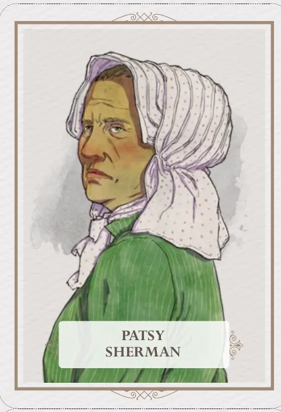
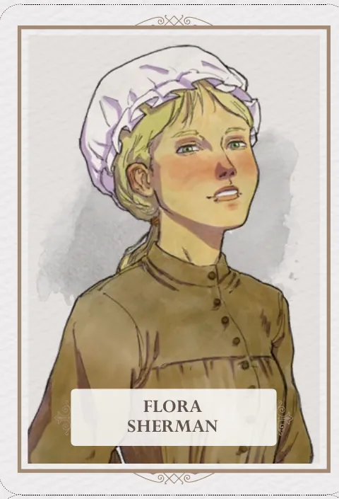
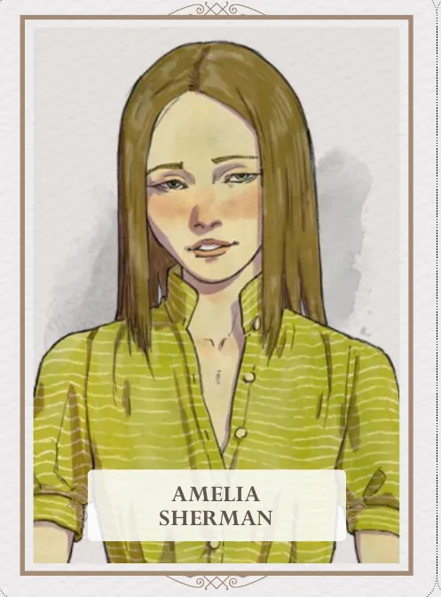
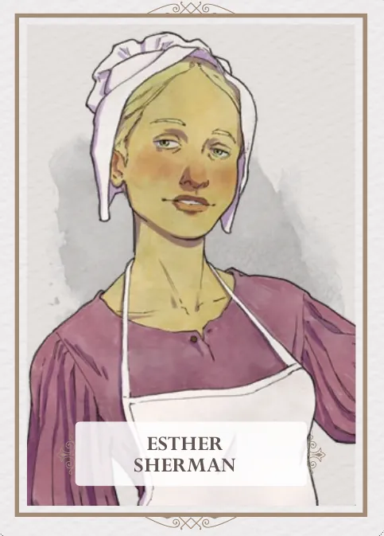

**Имущество:** в переднике у Пэтси заткнут маленький нож, которым она режет кур.

**Внешность и поведение:** она вечно вытирает руки о передник или хлопает в ладоши. Хотя с сыщиками она будет угодлива, полностью скрыть свою неприязнь ей не удастся. Если упрекнуть её поведением дочерей, она изобразит удивление и воскликнет, что ничего подобного прежде никогда не случалось. И сделает это глазом не моргнув, несмотря на вопиющую ложь.

```stat
СИЛ 45   ВЫН 55   ТЕЛ 50   ЛВК 55   ИНТ 65
НАР 45   МОЩ 65   ОБР 55   Рассудок 13   ПЗ 10

Бонус к урону: нет.
Комплекция: 0
Скорость: 6
Ближний бой (драка) 35% (17/7), урон 1d4+БкУ.
Уклонение 55% (27/11).
Навыки: Обращение с животными 50%, Искусство/ремесло (сыроварение) 60%, Искусство/ремесло (кулинария) 55%, Искусство/ремесло (огородничество) 50%, Искусство/ремесло (стрижка овец) 55%, Обаяние 35%, Лазание 30%, Средства 09%, Уклонение 55%, Красноречие 55%, Ближний бой (драка) 35%, Стрельба (винтовка/дробовик) 20%, Первая помощь 35%, Прыжки 30%, Родной язык (английский) 55%, Слух 50%, Естествознание 40%, Ориентирование 30%, Оккультизм 30%, Психология 45%, Внимание 50%, Скрытность 65%, Выживание (горы) 25%, Плавание 25%, Метание 30%, Чтение следов 40%.
```



## Эстер, Амелия и Флора Шерман

*26, 23 и 17 лет. Сладострастные пастушки. Рабочий класс (бедные).*

Дочери Шерманов считают себя наследницами древней местной матриархальной друидской традиции. Вмешательство доктора, который не раз гипнотизировал трёх молодых женщин, тоже не слишком способствовало здоровому развитию их личности.

Барышни прячут свои провокации за напускной застенчивостью, но тонкими их не назовёшь. Они играют роль сексуальной приманки, за которой гоняются сыщики. Если сыщики попытаются их поймать, они убегут, но всегда стараясь не скрыться из виду преследователей, чтобы погоня продолжалась. Они побегут в лес, оставляя за собой дорожку из сброшенной одежды, по которой будет нетрудно идти и которая приведёт к древним римским руинам. Они могут также притвориться, будто их застали врасплох, когда они купаются нагишом в одной из маленьких бухт на побережье у замка Дьюар, складывают солому в амбаре или чистят горячих коней в конюшне под голодным похотливым взглядом Гаррета. Если сыщики их заметят, они сразу это почувствуют и начнут друг с другом всевозможные эротические игры, чтобы раззадорить их. Если какую-нибудь из них схватят силой, её поведение будет плавно переходить от покорности беспомощной и испуганной жертвы к откровенной, непрекращающейся провокации.






