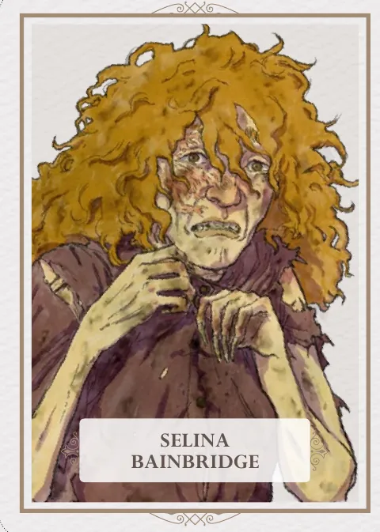

**Имущество:** венки и букеты цветов, а иногда — острые бронзовые серпы.

**Внешность и поведение:** за образец возьмите любую нарочито откровенную порносцену, какую вам доводилось видеть.

```stat
СИЛ 45   ВЫН 60   ТЕЛ 50   ЛВК 65   ИНТ 60
НАР 80   МОЩ 70   ОБР 55   Рассудок 09   ПЗ 11

Бонус к урону: нет.
Комплекция: 0
Скорость: 8
Ближний бой (драка) 35% (17/7), урон 1d4+2+БкУ.
Уклонение 55% (27/11).
Навыки: Обращение с животными 40%, Искусство/ремесло (составление букетов) 30%, Обаяние 55%, Лазание 50%, Средства 01%, Уклонение 55%, Ближний бой (драка) 35%, Первая помощь 35%, Прыжки 50%, Родной язык (английский) 55%, Слух 70%, Естествознание 50%, Ориентирование 50%, Оккультизм 40%, Убеждение 40%, Психология 30%, Верховая езда 25%, Ловкость рук 45%, Внимание 65%, Скрытность 65%, Выживание (горы) 30%, Плавание 55%, Метание 50%, Чтение следов 55%.
```

*Прим. перев.: в оригинале характеристика внешности подписана «APA» (от испанского «Apariencia») вместо «APP»; значение 80 — это НАР.*

## Селина Бейнбридж

*33 года. Дикарка. Рабочий класс (нищая).*



Селина — ещё один неудачный опыт лэрда. На этот раз экспериментальная операция на голосовых связках лишила её способности издавать какие-либо звуки, кроме гортанного визга. При внимательном осмотре на шее видны шрамы от операции. Ожоги же, покрывающие половину её лица, видны и без всякого осмотра.

Много месяцев она провела в свинарнике Шерманов, где спала вместе со свиньями, и одичала, утратив те немногие остатки рассудка, что у неё ещё оставались. Если показать ей медальон, она может на него отреагировать, но ничего полезного сыщикам рассказать не сможет.

**Внешность и поведение:** болезненная и тощая, с лихорадочным, безумным, полным страха взглядом. Она вся в грязи. Волосы и ногти отросли длинными и спутанными, но не скрывают рубцов на лице. Говорить она не может. Она смертельно боится, что её найдут и потащат обратно в особняк.

```stat
СИЛ 50   ВЫН 45   ТЕЛ 50   ЛВК 55   ИНТ 60
НАР 65   МОЩ 45   ОБР 55   Рассудок 00   ПЗ 9

Бонус к урону: нет.
Комплекция: 0
Скорость: 8
Ближний бой (драка) 55% (27/11), урон 1d3+БкУ.
Уклонение 42% (21/8).
Навыки: Обращение с животными 40%, Искусство/ремесло (чесание шерсти) 30%, Лазание 50%, Средства 00%, Уклонение 42%, Ближний бой (драка) 55%, Прыжки 40%, Слух 70%, Внимание 30%, Скрытность 60%.
```

## Мистер Джулиус Коллингвуд

*36 лет. Художник. Высший класс (состоятельный).*

Джулиус страдает тяжёлым алкоголизмом, из-за которого у него развился синдром Вернике — Корсакова. В его памяти есть пробелы, и мозг заполняет их, сам придумывая недостающие подробности, поэтому художник особенно восприимчив к внушению со стороны.

От абстиненции у него к тому же дрожат руки, и писать картины он больше не может, хотя сам этого не осознаёт и считает, что переживает пору творческого расцвета, — и это правда в те редкие разы, когда ему удаётся раздобыть выпивку.

На его работы влияют посещения царства мёртвых. Лорд Дьюар считает, что художник мог бы стать запасным сосудом для Артура, случись с мистером Бедфордом какое-нибудь несчастье.

**Имущество:** пустая фляжка, а иногда — ключи от собственной комнаты.
