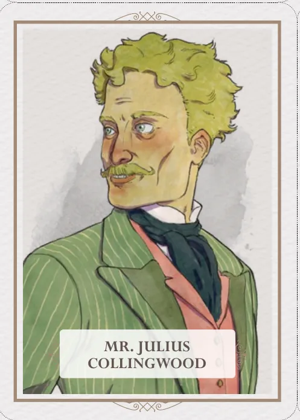

**Внешность и поведение:** он уже не молод, но ещё не дорос до статуса интригующего пожилого джентльмена. Экстраверт до истеричности, самоуверенный и галантный, с громовым смехом. Он чрезвычайно высокого мнения о себе и своём искусстве и делает вид, что не замечает никакой критики. Улыбается и размашисто жестикулирует, излучая непоколебимую уверенность в себе, но не может скрыть лёгкой дрожи в руках. Чтобы войти в образ, вспомните Хью Лори в одном из его скетчей в духе «Монти Пайтона» или слегка «приглушённую» версию Рика Мэйолла из «Молодых».

```stat
СИЛ 60   ВЫН 40   ТЕЛ 60   ЛВК 85   ИНТ 70
НАР 65   МОЩ 65   ОБР 65   Рассудок 00   ПЗ 10

Бонус к урону: нет.
Комплекция: 0
Скорость: 8
Стрельба (пистолет) 32%* (16/6), урон 1d6+1 (выстрелов за раунд: 1/4; патронов: 1; осечка: 95).
Ближний бой (меч) 32%* (16/6), урон 1d6+1+БкУ.
Ближний бой (драка) 40% (20/8), урон 1d3+БкУ.
Уклонение 50% (25/10).
Навыки: Оценка 30%, Искусство/ремесло (изобразительное искусство) 96%*, Обаяние 40%, Средства 65%, Уклонение 50%, Красноречие 70%, Ближний бой (драка) 40%, Ближний бой (меч) 32%*, Стрельба (пистолет) 32%*, История 40%, Иностранный язык (французский) 20%, Родной язык (английский) 65%, Работа в библиотеке 40%, Слух 50%, Взлом 12%*, Естествознание 20%, Оккультизм 17%, Убеждение 30%, Психология 30%, Верховая езда 30%, Ловкость рук 24%*, Внимание 40%, Скрытность 40%.

* Если он выпил; иначе берите лишь четверть процента.
```

## Миссис Генриетта (Этти) Юнис

*71 год. Ясновидящая и медиум. Средний класс.*

Ясновидящая Этти Юнис больна туберкулёзом. Возможно, именно эта близость к царству мёртвых и позволяет ей так легко проникать за завесу. Лорд Дьюар собирается сделать её сосудом для души своей матери, когда та умрёт, хотя ей самой он, конечно, об этом не сказал.

Если сыщики решат не подвергать себя действию машины Харона, вы можете передать сцены, описанные в отпечатках, через экстрасенсорное восприятие Генриетты. Для этого ясновидящая должна оказаться в нужном месте и получить возможность расслабиться и настроить свои энергии на окружающую обстановку, отчего доступ к некоторым сценам станет труднее. Кроме того, некоторые из описанных отпечатков не имели бы смысла в устах Этти, ведь они посвящены глубокому исследованию души самих персонажей, а не психическим следам, оставленным в окружающем мире.

**Имущество:** колода карт; маленький флакон с пипеткой — по идее, с лекарством от кашля; окровавленный носовой платок; ключи от её покоев и от наружной двери столовой санатория.

**Внешность и поведение:** одета в строгий траур, сгорблена, украдкой поглядывает по сторонам. Изо всех сил старается казаться как можно загадочнее. У неё жуткий кудахтающий смех, который неизменно переходит в хриплый приступ кашля.

```stat
СИЛ 25   ВЫН 35   ТЕЛ 45   ЛВК 50   ИНТ 70
НАР 45   МОЩ 98   ОБР 75   Рассудок 34   ПЗ 8

Бонус к урону: −1
Комплекция: −1
Скорость: 4
```
