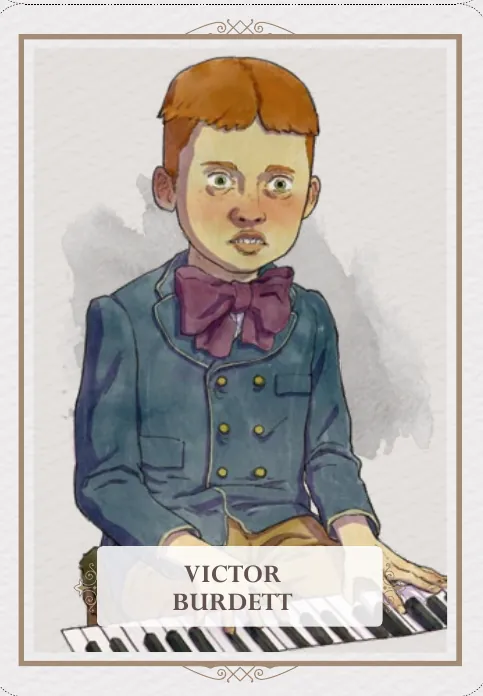

```stat
Ближний бой (драка) 28% (14/5), урон 1d3+БкУ.
Уклонение 30% (15/6).
Навыки: Антропология 40%, Археология 20%, Искусство/ремесло (гадание) 70%, Обаяние 35%, Средства 45%, Уклонение 30%, Красноречие 70%, Ближний бой (драка) 28%, Первая помощь 40%, История 60%, Запугивание 30%, Иностранный язык (французский) 30%, Иностранный язык (латынь) 20%, Родной язык (английский) 75%, Работа в библиотеке 60%, Слух 65%, Оккультизм 60%, Убеждение 68%, Психология 85%, Чтение по губам 30%, Наука (астрономия) 20%, Ловкость рук 50%, Внимание 70%, Скрытность 30%.
```

## Виктор Бердетт

*11 лет. Слепой пианист. Высший класс (состоятельный).*



Маленький Виктор не выдержал давления, которое оказывала на него семья, и в конце концов сломался, убив их всех в кровавом исступлении. Он всегда завидовал сестре — вплоть до желания стать ею, — потому что чувствовал, что от неё требуют меньше, чем от него. Вероятно, и его гендерная идентичность отличается от того, как она выражается внешне, хотя викторианские умы его времени вряд ли допустили бы такую возможность.

У Виктора особая синестезия: музыку он воспринимает не только слухом. Она может обжечь его, причинить ему боль и т. д. Его слепота не органического происхождения: это своего рода истерический амавроз, вызванный сиделкой Реддинг.

**Имущество:** вышитый надушенный носовой платок, принадлежавший его сестре.

**Внешность и поведение:** он ни на что конкретно не смотрит, а глядит куда-то вдаль. Моргает он редко, а если и моргает, то очень нарочито. В глаза собеседнику не смотрит. Всегда держит прямую осанку пианиста и говорит монотонно, вычурными оборотами и словами, неожиданными для ребёнка его возраста. Изображая его, можно отчасти вдохновиться Шелдоном из «Теории большого взрыва».

```stat
СИЛ 35   ВЫН 45   ТЕЛ 35   ЛВК 80   ИНТ 80
НАР 60   МОЩ 25   ОБР 75   Рассудок 00   ПЗ 8

Бонус к урону: −1
Комплекция: −1
Скорость: 8
Ближний бой (драка) 00% (0/0), урон 1d3+БкУ.
Уклонение 00% (0/0).
Навыки: Искусство/ремесло (игра на фортепиано) 70%, Средства 80%, Маскировка 45%, Уклонение 00%, Ближний бой (драка) 00%, Иностранный язык (немецкий) 20%, Иностранный язык (итальянский) 20%, Родной язык (английский) 75%, Слух 90%, Внимание 00%, Скрытность 45%.
```

## Ральф Лаверик

*55 лет. Забинтованный с головы до ног пациент, прикованный к инвалидному креслу. Средний класс.*

Неясно, был ли этот священник из Уайтчепела причастен к преступлениям Джека-потрошителя и почему он весь в бинтах — из-за жутких опытов доктора Дьюара или от ран, которые он нанёс себе сам. Ясно одно: после экспериментальной операции лэрда он не смог бы дать сыщикам почти никаких полезных сведений, даже если бы захотел.

**Внешность и поведение:** он прикован к инвалидному креслу, тело и лицо обмотаны бинтами, говорить он не может. Всё, что ему удаётся, — издавать хриплые, глухие, жалкие стоны, словно кто-то наступил ему на ногу, а голоса пожаловаться нет. Чтобы добиться этого тревожного эффекта, издавайте звуки только на вдохе.
