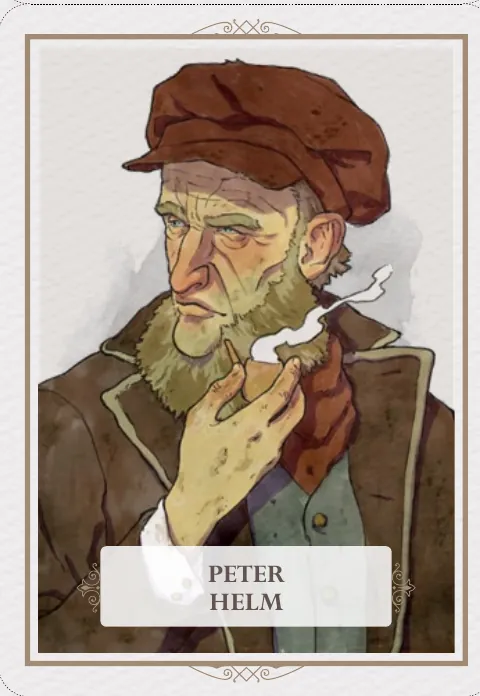
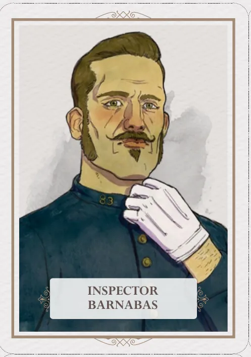

## Питер Хелм

*44 года. Браконьер-ловец крабов. Рабочий класс (нищий).*



Этот человек знал Артура и Джаспера и даже однажды спас Артуру жизнь, когда тот был ещё мальчишкой. Всю жизнь он ловит крабов у этих берегов и бросать это дело не собирается.

Знакомя сыщиков с Питером Хелмом, важно не дать им с ходу назвать свои имена — например, пусть он воскликнет: «Вы ведь не работаете на этого ублюдка Дьюара? Пусть он и вся его семейка гниют в аду!» Иначе тайна замка Дьюар может раскрыться раньше времени. Другой вариант: первые несколько раз, когда сыщики его видят, рыбак запрыгивает в лодку и уплывает на вёслах, прежде чем они успеют к нему подойти, — ведь он знает, что занимается незаконным делом.

**Имущество:** ножик, огниво и горсть крабов. В лодке у него может быть и ящик вина в зелёных бутылках — вроде тех, из которых, как могли видеть сыщики, пьёт конюх.

**Внешность и поведение:** бородатый, растрёпанный и состарившийся раньше времени (выглядит лет на десять старше своих лет), но с живым блеском в глазах. Пахнет солью и дымом; его часто можно застать за тем, как он обсасывает с пальцев остатки краба.

```stat
СИЛ 65   ВЫН 55   ТЕЛ 65   ЛВК 75   ИНТ 60
НАР 55   МОЩ 45   ОБР 45   Рассудок 45   ПЗ 12

Бонус к урону: +1d4
Комплекция: 1
Скорость: 7
Ближний бой (драка) 60% (30/12), урон 1d4+БкУ.
Уклонение 60% (30/12).
Навыки: Искусство/ремесло (рыбная ловля) 50%, Лазание 70%, Средства 00%, Подводное плавание 30%, Уклонение 60%, Ближний бой (драка) 60%, Первая помощь 30%, Прыжки 70%, Родной язык (английский) 45%, Слух 70%, Естествознание 40%, Ориентирование 50%, Пилотирование (лодка) 50%, Внимание 70%, Скрытность 60%, Плавание 60%, Чтение следов 40%.
```

## Инспектор Барнабас (Барни) Гонтлетт и его люди

*47 лет. Инспектор полиции Скотленд-Ярда. Средний класс.*



Персонажам вряд ли придётся иметь дело с Барни или его людьми иначе, чем в бою. Полиция опознает их и попытается схватить. Хотя полицейские дадут им шанс сдаться, если те не сдадутся, без колебаний откроют огонь.
