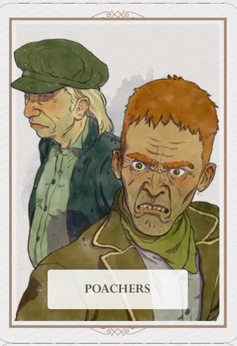

**Имущество:** полицейская дубинка и пистолет.

**Внешность и поведение:** серьёзный и высокомерный, подозрительный, но вежливый. Изображая его, вспомните Северуса Снегга из «Гарри Поттера» или инспектора Жавера из любой телевизионной, кино- или театральной постановки «Отверженных» Виктора Гюго.

```stat
СИЛ 60   ВЫН 60   ТЕЛ 70   ЛВК 60   ИНТ 65
НАР 65   МОЩ 65   ОБР 60   Рассудок 65   ПЗ 13

Бонус к урону: +1d4
Комплекция: 1
Скорость: Барни 6, остальные его люди 7.
Стрельба (пистолет) 50% (25/10), урон 1d6 (выстрелов за раунд: 1; патронов: 1; осечка: 98).
Ближний бой (драка) 40% (20/8), урон 1d6+БкУ.
Уклонение 50% (25/10).
Навыки: Оценка 15%, Обращение с животными 30%, Средства 20%, Уклонение 50%, Вождение автомобиля 40%, Ближний бой (драка) 40%, Стрельба (пистолет) 50%, Первая помощь 30%, Запугивание 60%, Родной язык (английский) 60%, Юриспруденция 35%, Слух 50%, Механика 30%, Убеждение 30%, Психология 40%, Наука (криминалистика) 10%, Внимание 60%, Скрытность 30%, Чтение следов 30%.
```

## Браконьеры

*35 лет. Браконьеры. Рабочий класс (бедные).*



Эти люди охотятся в частных угодьях лэрда, зная, что разрешения у них нет и что, если их поймают, им грозят серьёзные последствия по закону. Ввязываться в перестрелку с сыщиками они не хотят, но, если на них нападут, будут защищаться.

**Имущество:** дробовик, охотничий нож, манок, фляжка и припасы.

**Внешность и поведение:** грязные, грубые и неопрятные. Постоянно ворчат и прикладываются к своим фляжкам.

```stat
СИЛ 65   ВЫН 55   ТЕЛ 75   ЛВК 65   ИНТ 55
НАР 50   МОЩ 45   ОБР 45   Рассудок 45   ПЗ 13

Бонус к урону: +1d4
Комплекция: 1
Скорость: 7
Стрельба (винтовка/дробовик) 60% (30/12), урон 4d6+2/2d6+1/1d4 (выстрелов за раунд: 1 или 2; патронов: 2; осечка: 100).
Ближний бой (драка) 50% (25/10), урон 1d4+2+БкУ.
Уклонение 45% (22/9).
Навыки: Обращение с животными 35%, Искусство/ремесло (добыча пушнины капканами) 40%, Лазание 50%, Средства 06%, Уклонение 45%, Ближний бой (драка) 50%, Стрельба (винтовка/дробовик) 60%, Первая помощь 30%, Запугивание 30%, Прыжки 30%, Родной язык (английский) 45%, Слух 40%, Механика 25%, Естествознание 40%, Ориентирование 30%, Внимание 30%, Скрытность 60%, Выживание (горы) 40%, Чтение следов 50%.
```
