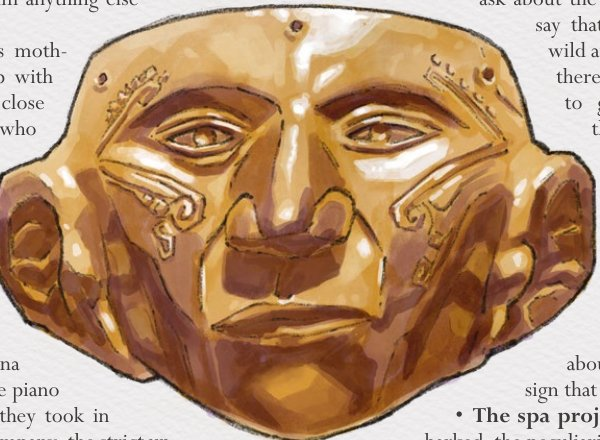

и убеждённостью, что вы невольно заслушиваетесь, ловя каждое его слово».

## Лорд Амадеус Дьюар

- Его путешествия по бассейну Амазонки в поисках **источника вечной молодости** по стопам своего кумира Понсе де Леона, а также его научные изыскания на эту тему, которые однажды привели его к тайным архивам самого Ватикана, где в старинных томах он узнал то, что поклялся никогда не раскрывать.
- Другие **столь же фантастические истории его экспедиций** — например, как в Гималаях, разыскивая затерянное царство Шамбалу, он столкнулся лицом к лицу со снежным человеком или как ему удалось выследить мифическое существо, которое теперь выставлено в Галерее химер, — о чём, как он тут же понимает, ему явно не стоило упоминать.
- Экзотические (а порой и отвратительные) **блюда, которые он пробовал** в путешествиях, и странные кулинарные обычаи некоторых племён, а также галлюциногенное (или нет?) действие, которое он испытал, когда его пригласили участвовать в некоторых туземных обрядах, запретных для белого человека.
- Необычное происхождение многих **увечий, которые его мучают**, — вероятно, того, из-за которого он хромает: оно самое заметное из всех, а получил он его в схватке с некими химерическими существами… но — ох — вот он опять упоминает их, сам того не желая, так что, пожалуйста, больше ни о чём его об этом не спрашивайте!
- **История его семьи**: прекрасные отношения его матери с Тведдлом — близким другом его отца, который утешал леди Эдну после того, как лорд Оуэн погиб, неудачно упав с лестницы, и от чьей привязанности родилась его сестра Фиделия, с которой он был очень близок; редкий музыкальный талант леди Эдны и то, как они наслаждались рассказами и обществом друг друга; строгое воспитание, которое дал ему отец и которое в конце концов окупилось, подготовив его к опасностям, что позже встретились ему на жизненном пути; и т. д.
- Любопытные **околосмертные переживания** (разумеется, все до одного правдивые), о которых рассказывают люди, побывавшие на пороге смерти, и призраки и привидения, населяющие некоторые места (тоже, конечно, настоящие), а также его интерес к исследованию этой области науки… хотя заводить об этом речь ему точно не следовало.
- **История замка Дьюар** и любых интересных мест, которые персонажи могли обнаружить или хотели бы посетить, — особенно римских руин, разбросанных тут и там по поместью, и история первых римских поселенцев, зверски убитых дикими племенами, которые ещё населяли эти земли после того, как их сочли усмирёнными.
- **Любые слухи о замке Дьюар, которые могли слышать сыщики**: он будет их отрицать или раздувать в зависимости от настроения в тот день и от того, выгодно ли это ему (см. другие темы разговора). Лишь лорд Дьюар держит в руках ключи ко всему. Если его спросят о сокровище инков, он скажет, что продал его, — правда, не вдаваясь в подробности, ведь он не хочет лишать сыщиков стимула, который может дать им надежда его найти, — и посмеётся над мыслью, что на нём может лежать проклятие. Если спросят об охоте на людей, объяснит, что его отец, когда сам Амадеус был молод, однажды поймал и казнил нескольких браконьеров — таково было его право и обязанность как лэрда этих земель, — а сплетники воспользовались этой историей, чтобы выставить его чудовищем и окружить его имя мрачной легендой. Если спросят об охотничьих угодьях, скажет, что там действительно полно диких зверей и медвежьих капканов, а потому бродить там небезопасно, но никаких сверхъестественных чудовищ в лесу не водится, ничего подобного. И так далее. Его прямоту и нежелание пускаться в привычные полёты фантазии на эти темы сыщики, вероятно, сочтут явным признаком того, что он им лжёт.
- **Затея с санаторием**, за которую он взялся, странности постояльцев, которые сейчас там живут, и финансовое положение лэрда, которое, как он заверит, ничуть не бедственное. За новое дело он взялся из чисто альтруистических

