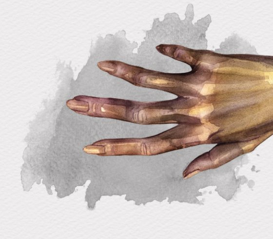

## Художник Джулиус Коллингвуд

- **Его картины и сны**: как его поразил внезапный упадок вдохновения, повергший его в глубокое отчаяние, и как он вновь обрёл своих муз в этом санатории. Может, дело в свойствах воды, а может, в слиянии мистических энергий, но, какова бы ни была причина, сны в замке Дьюар совершенно не похожи на те, что снились ему где-либо ещё, и, хотя они тревожны, они раскрепощают его творческие силы. Он черпает в них сырой материал для своих живописных композиций.
- Его богатый **опыт сомелье**: свойства и особенности разных бренди, виски и ликёров; лучшие и худшие урожаи разных вин; и даже достоинства разных сортов пива. Он не постесняется предложить сыщикам устроить слепую дегустацию (разумеется, тайком, чтобы не беспокоить лорда Дьюара), чтобы лучше поделиться своими познаниями в этих вопросах, — или любой другой столь же нелепый и откровенный предлог, чтобы ему раздобыли выпивку («Не желаете ли поставить на это бутылочку доброго хереса?»).
- **Выдумки** на любую тему, в которой художник ничего не смыслит, — из-за синдрома Корсакова. Обычно эти фантазии рождаются в ответ на вопросы сыщиков, и Коллингвуд сплетает их из тех сведений, что ему дали, словно актёр-импровизатор, развивающий подсказки, которые подбрасывают ему на сцене партнёры по труппе. Если сыщики спросят о каком-нибудь слухе, который могли слышать, Коллингвуд не только подтвердит, что это правда, но и добавит к вымыслу новые слои, доводя его до новых, совершенно неправдоподобных высот. Однако успешная проверка **Психологии** покажет, что этот человек действительно верит в то, что говорит, даже если это заведомая ложь. Если сыщики расскажут об этом странном поведении доктору Дьюару или сиделке Реддинг, те развеют загадку, по секрету (и умоляя соблюдать величайшую осторожность) открыв им болезнь художника и её причину.
- **Непристойное поведение пастушек**: он вспомнит, как, пользуясь тем, что он вечно ищет натурщиц, чтобы закончить свою «Венеру», они однажды попытались его заманить, сладострастно предлагая себя, пока у него не помутилось в голове, и увели его в лес. Там он обнаружил, что они устроили жертвенный алтарь, на котором лежал золотой серп, — им они, несомненно, собирались перерезать ему горло. К счастью, их планы сорвал мистер Дав, ворвавшийся на место в последнюю секунду. Одного его появления хватило, чтобы распугать этот ковен языческих гарпий.
- **Опыты лэрда**, в которых, должен признаться, он участвовал не раз и которые раздвинули границы его воображения, сделав его талантливее, чем когда-либо прежде. Именно им — а не свойствам воды, как он мог утверждать раньше, — он на самом деле приписывает перемены, которые в нём произошли. По его мнению, прямая связь с собственной душой, сбросившей оковы плотского тела, даёт несравненную степень самопознания и единения с космосом и позволяет открыться творческим сущностям окружающего мира и лучше их направлять. Если голод обостряет ум, то на что же способна сама Смерть?!

## Ясновидящая Генриетта (Этти) Юнис

- **Индия**: её святыни (и священные животные), религия, чайные кусты, хиджры — люди «третьего пола», — и особенно её необычные похоронные обычаи, например обычай бросать тела или прах умерших в Ганг, или поразительный обряд сати, при котором вдову или вдов покойного сжигают заживо вместе с ним на погребальном костре, чтобы они сопровождали его в последнем пути.
- **Мир призраков** и духов, разные теории о душе и загробной жизни, а также существование людей вроде неё, обладающих чувствительностью, необходимой для общения с мёртвыми, и неконтролируемые проявления заблудших душ и привидений, не обретших покоя после того, как сбросили бренную оболочку. Она может рассказать и о разных похоронных обычаях, призванных обеспечить мёртвым благополучный и лёгкий переход: например, о греческом обычае класть покойному в рот монету-обол как плату перевозчику Харону; об обычае отсекать руку у трупов тех, кто наложил на себя руки, чтобы обезвредить их и не дать их духам вернуться и
