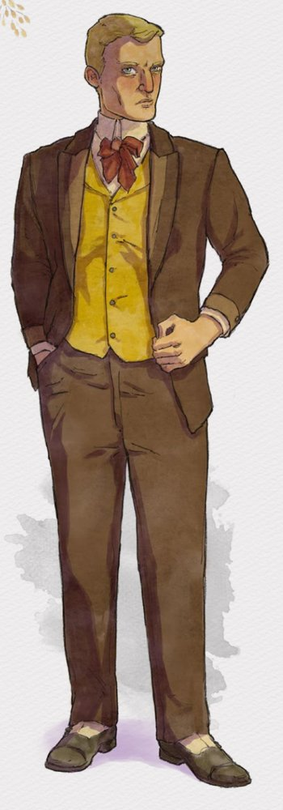

ночью Джонатан явился в башню замка Дьюар в старых стенах, где жили Артур с матерью. Джаспера и Артура не было, но дядя Амадеус был там, хотя старик почти не рассказывает о том, что случилось той ночью. Были крики и ссора, и вечер закончился трагедией: и Фиделия, и Джонатан погибли в пожаре.

В ярости на дядю, которого он отчасти винит в случившемся, Артур решил на скромное наследство, оставшееся от отца, покинуть замок Дьюар и вместе с Джаспером переехать в Лондон, где начал изучать право. Первые месяцы прошли в пьяном угаре разгула — в исступлённой попытке забыть. Затем однажды ночью он встретил мисс Глэдис Косгроув, актрису и оперную певицу, и у них начался страстный роман. Эти отношения несколько отдалили его от Джаспера, у которого были свои беды — с азартными играми, учёбой и семьёй, — и которому в конце концов пришлось бросить университет.

Ты заполнил интеллектуальную пустоту, оставленную Джаспером, сойдясь с Бьюфордом Гленом, Сэмюэлом Гейтсом, Лютером Эйвери, Перри Гилмором и Стивеном Дикином — студентами, интеллектуалами и пробивными дельцами, с которыми ты задумал заговор с целью убить королеву Англии Викторию. Твои идеалы черпают из луддизма (машины угрожают заработку людей), чартизма (революционного движения рабочего класса), шотландского сепаратизма и бредовой мешанины политических и псевдофилософских теорий. Но при всей твёрдости убеждений и глубокой преданности делу тебе не хватает денег. Ты истратил всё, что у тебя было, и действовать нужно быстро, пока ещё есть шанс.

Как обычно, выход находит Джаспер с его блестящим умом, — ему тоже не хватает денег. Ты, он и Глэдис придумываете план ограбить твоего дядю, доктора Амадеуса Дьюара, который, как уверяет Джаспер, прячет в своём особняке бесценное доколумбово сокровище.

К несчастью, неотложное дело чести — подробности которого здесь ни к чему — помешало планам компании: Артуру пришлось защищать своё доброе имя на дуэли насмерть, из которой он вышел победителем, хотя и с тяжёлой раной правой руки. Ввиду гибели молодого дворянина с хорошими связями (власти упорно квалифицируют это как убийство, хотя смерть наступила на дуэли), а также твоих планов и революционной компании, с которой ты водишься, решено было обратить эту неудачу себе на пользу. Сделав из нужды добродетель, вы отправитесь в замок Дьюар под предлогом тайного лечения, не привлекая внимания властей, хотя в спешке ты так и не успел спланировать само ограбление.
