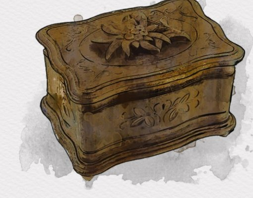

### Характер и окружение

**Описание:** хотя Артур элегантен, учтив и уравновешен, в тебе есть и угрожающая жёсткость, которую невозможно не заметить, и ледяной взгляд, не оставляющий сомнений в том, кто здесь хозяин.

**Идеалы и принципы (ключевая связь):** ты сделаешь всё, что потребуется, чтобы свергнуть империалистическую британскую монархию и поднять социальное восстание, основанное на верховенстве смиренного, угнетённого народа Шотландии. Долой напыщенную аристократию! Да здравствует революция!

**Значимые люди:** мисс Глэдис Косгроув, его милая невеста и восходящая звезда лондонской оперной сцены, в которую он влюблён по уши, даже если тебе порой приходится держать её на коротком поводке.

**Важные места:** руины форта, где при очень тёмных обстоятельствах погибли в огне его родители.

**Ценное имущество:** музыкальная шкатулка матери — единственная память о ней; должно быть, она всё ещё в замке Дьюар или даже сгорела в пожаре.

**Черты:** несмотря на фасад, который ты показываешь миру, в глубине души ты жестокий, властный, мстительный эгоист. Ты думаешь только о себе и, когда станет туго, будешь заботиться лишь о собственных интересах и без зазрения совести предашь друзей или уничтожишь любого, кто посмеет встать у тебя на пути.



## Мисс Глэдис Косгроув

*20 лет. Актриса, сопрано и драматург. Высший класс (состоятельная).*

### Характеристики

```stat
СИЛ 40   ВЫН 40   ТЕЛ 55   ЛВК 70   ИНТ 80
НАР 85   МОЩ 55   ОБР 75   Рассудок 55   ПЗ 9

Текущие ПЗ: 9
Удача: 40
Текущий Рассудок: 55
Скорость: 8
Комплекция: 0
Бонус к урону: нет
```

### Навыки

Оценка 10%, Искусство/ремесло (актёрская игра) 45%, Искусство/ремесло (танец) 17%, Искусство/ремесло (игра на фортепиано) 20%, Искусство/ремесло (драматургия) 25%, Искусство/ремесло (пение (сопрано)) 30%, Обаяние 70%, Средства 50%, Маскировка 25%, Уклонение 40%, Ближний бой (драка) 35%, Первая помощь 40%, История 25%, Родной язык (английский) 75%, Работа в библиотеке 45%, Слух 50%, Механика 14%, Убеждение 40%, Психология 50%, Верховая езда 30%, Внимание 30%, Скрытность 50%, Метание 30%.

### Бой

| Оружие | Шанс | Урон | Примечания |
|---|---|---|---|
| Без оружия | 35% | 1d3+БкУ | |
| Кочерга | 35% | 1d8+БкУ | |
| Нож маленький | 35% | 1d4+БкУ | |
| Рапира | 20% | 1d6+1+БкУ | |
| Пистолет кремнёвый | 20% | 1d6+1 | выстрелов за раунд: 1/4; патронов: 1; осечка: 95 |
| Охотничий дробовик | 20% | 4d6+2 / 2d6+1 / 1d4 | выстрелов за раунд: 1 или 2; патронов: 2; осечка: 100 |

### Предыстория

Хотя тебя ужасно тревожит то, что задумали Джаспер и Артур, выбора у тебя нет — приходится участвовать. Тебе срочно нужна крупная сумма, чтобы вызволить брата, который сейчас чахнет в темницах лондонского Тауэра, и оплатить астрономические гонорары дорогих адвокатов, способных вытащить его из передряги, в которую он угодил. Сэмюэл — человек
