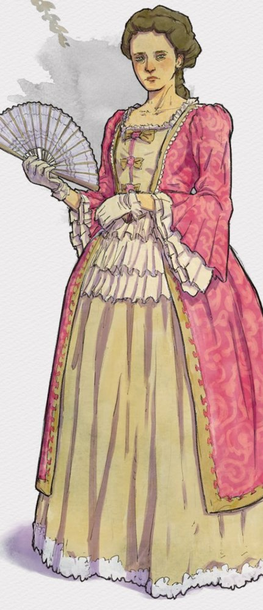

слабый: робкий, застенчивый мальчик, не созданный для суровой тюремной жизни. Когда ты навещала его в последний раз, у тебя едва не разорвалось сердце. Он был грязный, пепельно-серый, кожа да кости. И тебе совсем не понравился тот коварный кашель, который он не мог сдержать. Ты убеждена: если вскоре не вытащить его из этой дыры и не найти ему толковых адвокатов, брат умрёт. Поэтому ты решила связать свою судьбу с ними и помочь им украсть деньги у дяди Артура, лорда Амадеуса Дьюара, у которого большое состояние и, по словам Джаспера, несколько доколумбовых сокровищ, припрятанных с тех времён, когда он исследовал Амазонку.

Хотя… некоторые детали не сходятся, а к таким вещам ты очень чутка. Замок Дьюар, конечно, великолепное поместье, но недавно его превратили в закрытый санаторий для богатых постояльцев, а слуг у лорда Дьюара совсем мало. Зачем столь состоятельному человеку так поступать с собственным домом, если только ему отчаянно не нужны деньги? Конечно, это может быть всего лишь обычной причудой богача. Нетрудно представить, что бедняга повредился умом после того, как его сестра (мать Артура) погибла в пожаре в одном из зданий поместья, но что-то во всём этом кажется тебе неладным.

К тому же доктор Амадеус Дьюар — галантный и почтенный джентльмен, который всегда хорошо обходился с Глэдис, когда она летом гостила у него вместе с Артуром, своим женихом. У него превосходная конюшня, и Глэдис, сама искусная наездница, всегда с огромным удовольствием каталась верхом по охотничьим угодьям доктора. Ты бы предпочла, чтобы старик никогда не узнал об ограблении, и, главное, молишь Всевышнего, чтобы всё не вышло из-под контроля и никто серьёзно не пострадал. Лучше выждать и быть осмотрительной, чем потом сожалеть о большем зле, особенно если жертва — человек, ничем этого не заслуживший. Тебе совсем не по душе этот план.

Может, поэтому ты и потеряла голос.

Ну, не то чтобы потеряла. Говорить ты можешь и даже не охрипла, но с некоторых пор не можешь взять тех высоких нот сопрано, которыми Глэдис прославилась в оперном мире и покорила сердце Артура.

Как будто всего этого мало, из-за тяжёлого характера жениха пришлось спешить. Несколько дней назад Артур, не желая или не умея стерпеть оскорбление своей чести, убил на дуэли сына довольно известного дворянина. Он ранен в руку, и есть реальная угроза, что начнётся гангрена, если он не получит надлежащей медицинской помощи. Помощи, которую он не может получить обычным
