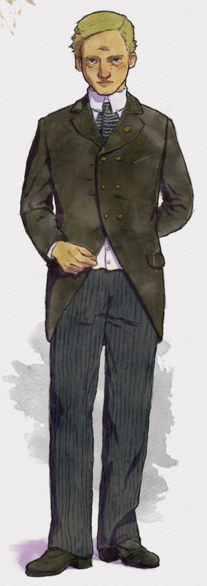

### Предыстория

У Джаспера сложные отношения с отцом. Сэр Эдмунд явно предпочёл бы дерзкого и самоуверенного наследника вроде Артура Уилтшира, а не то кроткое, трусливое, изнеженное создание, каким оказался его сын.

Сэр Эдмунд и доктор Амадеус Дьюар разделяли мужскую любовь к охоте и к путешествиям в доселе неизведанные и опасные края. Но если отец не мог понять сына, то лорд Дьюар ценил острый ум и художественную чуткость Джаспера, а также то взаимопонимание, братство и взаимную привязанность, какие бывают только между двумя мужчинами, — или, в данном конкретном случае, между взрослым мужчиной, которому есть чему научить, и мальчиком, жаждущим найти наставника, у которого можно учиться и который бы его ценил.

Лорд Дьюар уговорил сэра Эдмунда Брамли отправить Джаспера в замок Дьюар, чтобы тот стал его воспитанником. Отец был уверен, что бесстрашный доктор наделит сына недостающей тому мужественностью, и не подозревал, насколько противоположными были истинные намерения его товарища по экспедициям. Можно спорить, было ли это насилием — учитывая власть лэрда над неопытным юношей, — или юноша сам соглашался на его ухаживания и даже искал их, но на деле связь двух любовников никогда не была для обоих ничем иным, как источником радости и счастья… до того дня, когда в замок Дьюар приехали юный Артур Уилтшир и его мать Фиделия, единоутробная сестра лорда Дьюара по матери.

В тот день всё изменилось.

Джаспер мгновенно влюбился в мальчика, которого бросил отец, и вскоре они стали неразлучны. Конечно, Джаспер предпочёл бы сблизиться с новым другом ещё теснее, но ему было ясно, что Артур не понимает его ухаживаний и не отвечает на них.

Как бы то ни было, эти отношения охладили связь между Джаспером и лордом Дьюаром. Поэтому никого не удивило, что, когда после трагического пожара, унёсшего его мать Фиделию и недавно вернувшегося отца, Артур решил уехать учиться в далёкий Лондон, Джаспер решил отправиться с ним, тоже распрощавшись с доктором.

Первые месяцы прошли в тумане выпивки и распутства. Джасперу было скучно в университете, а у Артура оставалось всё меньше времени для старого друга, особенно после того, как он встретил очаровательную Глэдис Косгроув, актрису и оперную певицу, в которую влюбился с первого взгляда.

В итоге он бросил учёбу и стал проматывать ежемесячное содержание, которое получал от семьи, на всевозможные пустяки, но ничто не могло заполнить глубокую яму тоски внутри него.
