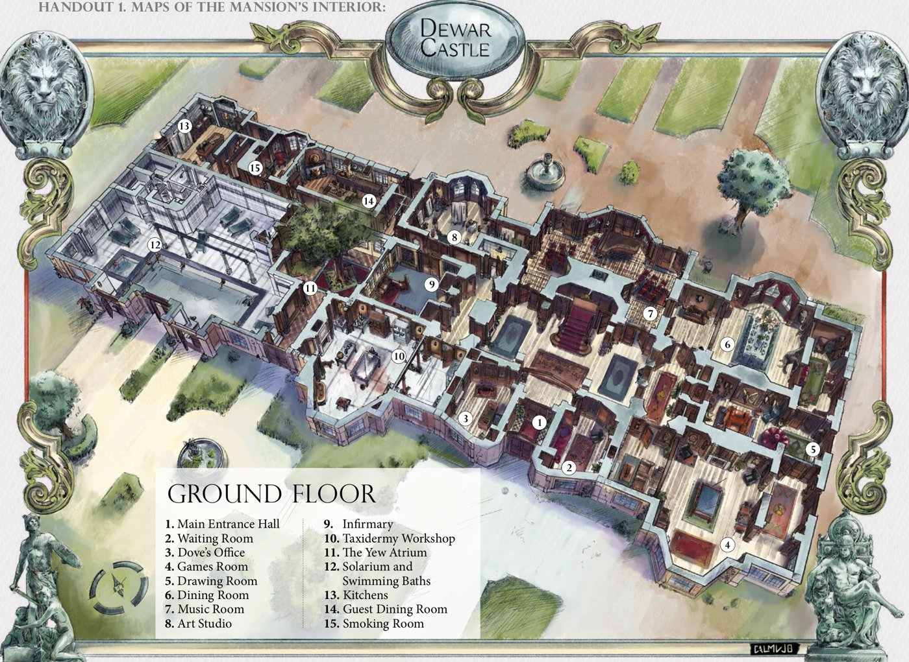

## Раздатка 1. Планы внутренних помещений особняка

**Первый этаж**

1. Главный вестибюль
2. Комната ожидания
3. Кабинет Дава
4. Игровая комната
5. Гостиная
6. Столовая
7. Музыкальный салон
8. Мастерская художника
9. Лазарет
10. Таксидермическая мастерская
11. Тисовый атриум
12. Солярий и бассейны
13. Кухня
14. Столовая для гостей
15. Курительная
