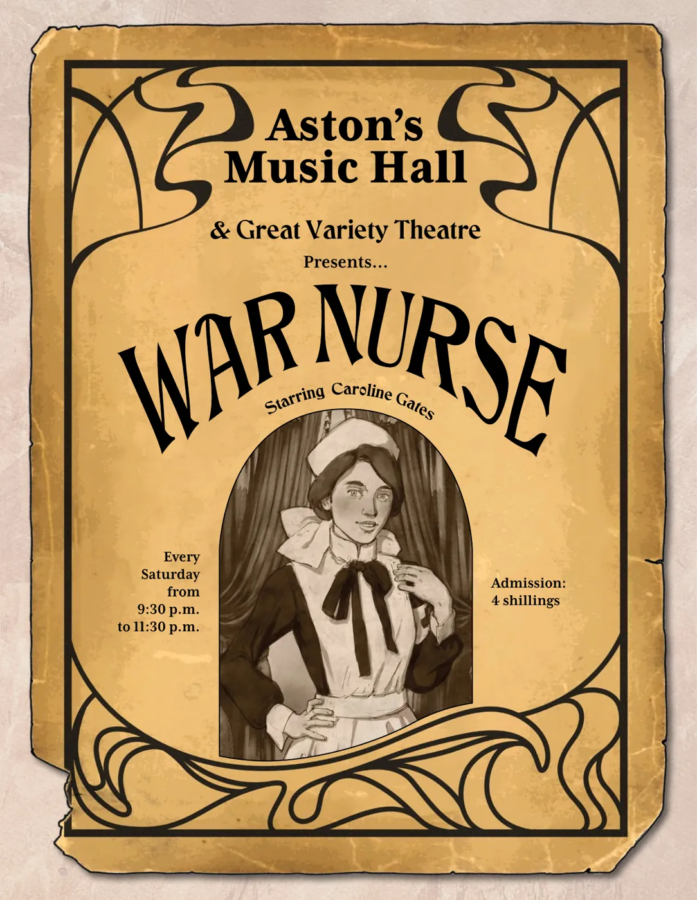

## Раздатка 4. Листовка мюзик-холла

> **Раздатка 4. Листовка мюзик-холла**
>
> **Мюзик-холл Астона и Большой театр варьете**
>
> представляют…
>
> **ВОЕННАЯ МЕДСЕСТРА**
>
> В главной роли — Кэролайн Гейтс
>
> [в центре — рисунок: актриса в форме медсестры]
>
> Каждую субботу с 21:30 до 23:30
>
> Вход: 4 шиллинга
