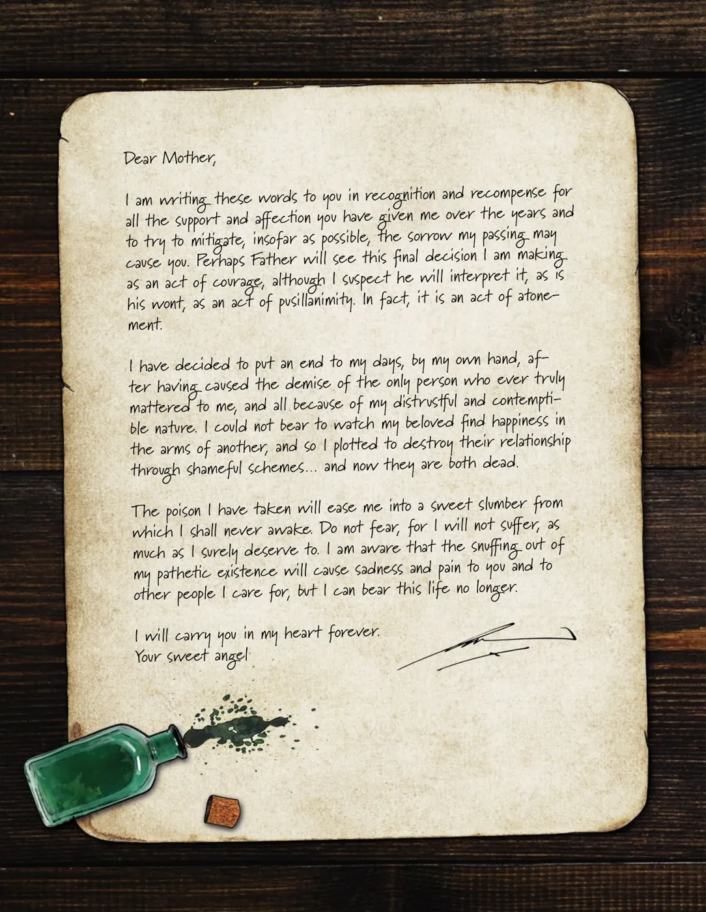

## Раздатка 5. Предсмертная записка

> **Раздатка 5. Предсмертная записка**
>
> Дорогая матушка,
>
> пишу Вам эти слова в знак признательности и в воздаяние за всю поддержку и любовь, что Вы дарили мне все эти годы, и чтобы по возможности смягчить горе, которое причинит Вам моя кончина. Быть может, отец увидит в этом последнем моём решении мужество, хотя, подозреваю, по своему обыкновению сочтёт его малодушием. На самом деле это искупление.
>
> Я решил покончить с собой собственной рукой, ибо стал причиной гибели единственного человека, который когда-либо по-настоящему был мне дорог, — и всё из-за моей недоверчивой и презренной натуры. Я не мог вынести, как мой любимый находит счастье в объятиях другой, и потому замыслил разрушить их союз постыдными кознями… и теперь они оба мертвы.
>
> Яд, который я принял, погрузит меня в сладкий сон, от которого я уже не проснусь. Не бойтесь: я не буду страдать так, как, несомненно, того заслуживаю. Я знаю, что угасание моего жалкого существования причинит печаль и боль Вам и другим дорогим мне людям, но выносить эту жизнь я больше не в силах.
>
> Я навсегда сохраню Вас в своём сердце.
>
> Ваш милый ангел
>
> [неразборчивая подпись; рядом — опрокинутый зелёный флакон и пробка]
