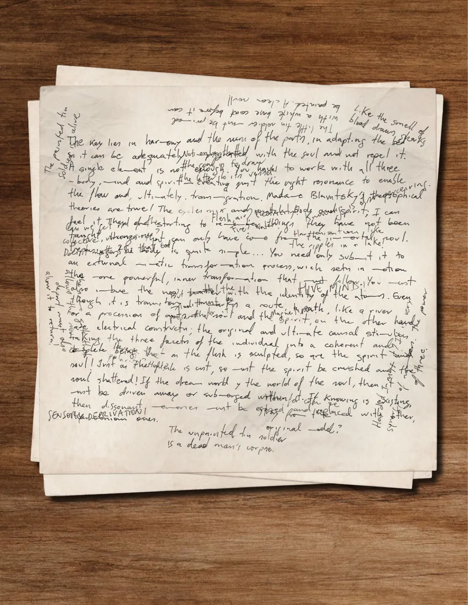

## Раздатка 6. Заметки доктора

> **Раздатка 6. Заметки доктора**
>
> Ключ — в гармонии и сумме частей, в том, чтобы приспособить тело так, чтобы оно должным образом [соединилось?] с душой и не отторгало её. Одного элемента недостаточно. Нужно работать со всеми тремя — телом, разумом и духом, — создавая ровно тот резонанс, что позволит течению и в конечном счёте переселению душ. Теософские теории мадам Блаватской верны! Циклы смешивают и [неразборчиво] тело и дух; я это чувствую. Они начинают вспоминать то, чему их не учили, — то, что могло прийти только от бессмертной души. [Важно ли это?] С телом всё просто… Достаточно подвергнуть его внешнему подражательному преображению, которое запускает единственное мощное внутреннее преображение, что неизбежно последует. Нужно также наделить новый [сосуд?] тождественностью атомов. Пусть он и временен, это путь, дорога, как река для шествия [души]. Душа же и дух — это электрические построения; изначальный и конечный причинный стимул, связывающий три грани личности в цельное и законченное существо. Как ваяют плоть, так ваяют и дух, и душу! Как режут [неразборчиво], так дух должен быть сломлен, а душа разбита! Если мир снов — мир души, то её нужно изгнать или утопить без него. Если знать — значит существовать, то несогласные воспоминания нужно стереть и заменить другими, [неразборчиво].
>
> Некрашеный оловянный солдатик — труп мертвеца.
>
> *Пометки поверх текста и на полях:* Оловянного солдатика нужно сперва загрунтовать белым, прежде чем красить. Чистая стена. — Как запах крови приманивает акул. — Раскрашенный оловянный солдатик живой. — Цель — привлечь вторую к её сосуду. — Восприятие. — Плоть, воздух, огонь, вода? — Это знание? — Гармонизация, как круги на озере! — Коллективное, бессознательное? — Подготовка? Этот Бог! — РОЕВОЙ РАЗУМ! — Но индивид должен… — Магнетизм. — Месть. — СЕНСОРНАЯ ДЕПРИВАЦИЯ! — Исходная модель? — Как согласовать… трёх. — Сама сила.

*Прим. перев.: в книге раздатка напечатана только картинкой; текст переписан с игровой раздатки, неразборчивые места — в квадратных скобках.*
