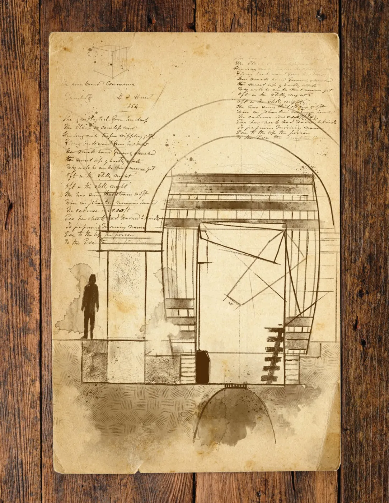

## Раздатка 7. Чертёж чана

> **Раздатка 7. Чертёж чана**
>
> [чертёж большого чана в разрезе — с лестницей, перегородками и фигурой человека для масштаба; на полях — рукописные стихи]
>
> «Пробуждённая совесть»
>
> [неразборчиво]   У. Х. Хант
>
> 1854.
>
> Она вырвалась из объятий,  
> Таких беспечных теперь;  
> Её длинные пышные локоны ещё струятся,  
> Отброшенные со лба.  
> Маленькая рука яростно сжата,  
> Милые губы мертвенно-белы;  
> Зачем он снова будит тот напев —  
> «Часто в тиши ночной»?
>
> «Часто в тиши ночной»  
> Она пела этот мотив так часто,  
> Когда ни одно призрачное воспоминание не тревожило  
> Его тихий, нежный лад;  
> Прежде чем её щека научилась вспыхивать  
> От кощунственных пылких имён;  
> Прежде чем к губам пришёл яд,  
> А к глазам — искуситель.

*Прим. перев.: в книге раздатка напечатана только картинкой; текст переписан с игровой раздатки, неразборчивое — в квадратных скобках.*
