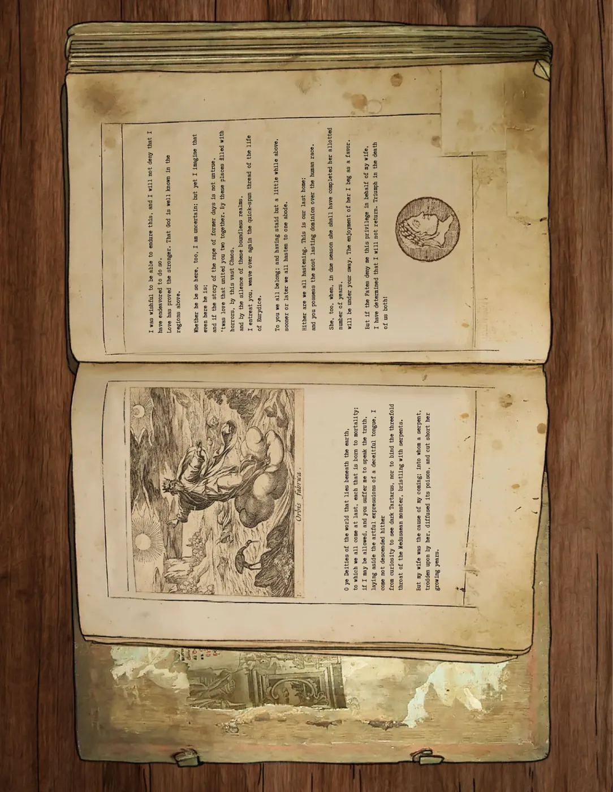

## Раздатка 8. Отрывок из «Метаморфоз» Овидия

> **Раздатка 8. Отрывок из «Метаморфоз» Овидия**
>
> О божества мира, что лежит под землёй, куда все мы, рождённые смертными, приходим в конце концов! Если мне позволено и вы дозволите мне говорить правду, отбросив хитрые речи лживого языка, — я спустился сюда не из любопытства увидеть мрачный Тартар и не затем, чтобы связать тройную глотку медузейского чудовища, ощетинившегося змеями.
>
> Причиной моего прихода стала жена: змея, на которую она наступила, излила в неё яд и оборвала её юные годы.
>
> Я хотел вынести это и не стану отрицать, что пытался. Любовь оказалась сильнее. Этот бог хорошо известен в горних краях.
>
> Известен ли он и здесь, не знаю; но думаю, что и здесь он есть; и если предание о давнем похищении не ложно, то и вас соединила любовь. Этими местами, полными ужасов, этим необъятным Хаосом и безмолвием этих безграничных царств заклинаю вас: сплетите заново слишком быстро спрядённую нить жизни Эвридики.
>
> Мы все принадлежим вам; и, задержавшись ненадолго наверху, рано или поздно все мы спешим в одну обитель.
>
> Сюда все мы спешим. Это наш последний дом, и вы владеете самой долгой властью над родом людским.
>
> И она, когда в свой срок исполнит отпущенное ей число лет, будет под вашей властью. Я прошу лишь в дар — дать мне насладиться ею.
>
> Если же судьбы откажут мне в этой милости для жены, я решил не возвращаться. Торжествуйте же над смертью нас обоих!
