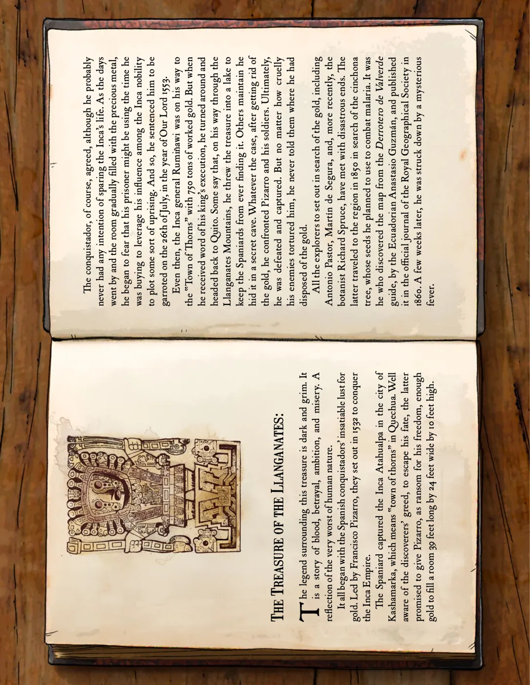

## Раздатка 9. Сокровище Льянганатес

> **Раздатка 9. Сокровище Льянганатес**
>
> **Сокровище Льянганатес:**
>
> Легенда об этом сокровище мрачна и зловеща. Это история крови, предательства, честолюбия и горя. Отражение худшего, что есть в человеческой природе.
>
> Всё началось с ненасытной жажды золота испанских конкистадоров. Во главе с Франсиско Писарро они в 1532 году отправились покорять империю инков.
>
> Испанец захватил инку Атауальпу в городе Кашамарка, что на кечуа значит «город шипов». Хорошо зная алчность первооткрывателей, тот, чтобы избежать своей участи, пообещал дать Писарро в выкуп за свою свободу столько золота, сколько поместится в комнату длиной 13 метров, шириной 8 и высотой 3 метра.
>
> Конкистадор, разумеется, согласился, хотя, вероятно, и не собирался щадить инку. Дни шли, комната понемногу наполнялась драгоценным металлом, и он стал опасаться, что пленник использует выигранное время, чтобы с помощью своего влияния на знать инков затеять восстание. И потому приговорил его к удушению гарротой 26 июля лета Господня 1553.
>
> Даже тогда генерал инков Руминьяви был на пути в «Город шипов» с 750 тоннами обработанного золота. Но, получив весть о казни своего короля, он повернул назад, к Кито. Одни говорят, что по пути через горы Льянганатес он бросил сокровище в озеро, чтобы испанцы никогда его не нашли. Другие утверждают, что он спрятал его в тайной пещере. Как бы то ни было, избавившись от золота, он вступил в бой с Писарро и его солдатами. В конце концов он был разбит и схвачен. Но как бы жестоко его ни пытали враги, он так и не сказал им, куда дел золото.
>
> Все исследователи, отправлявшиеся на поиски золота, — в том числе Антонио Пастор, Мартин де Сегура и, совсем недавно, ботаник Ричард Спрус — кончили плохо. Последний приехал в этот край в 1850 году в поисках хинного дерева, чьи семена собирался использовать против малярии. Именно он обнаружил карту из путеводителя «Дерротеро де Вальверде» эквадорца Анастасио Гусмана и опубликовал её в официальном журнале Королевского географического общества в 1860 году. Через несколько недель его сразила таинственная лихорадка.

*Прим. перев.: год казни Атауальпы напечатан «1553» (в книге и на игровой раздатке); исторически — 1533. Оставлено как в оригинале.*
