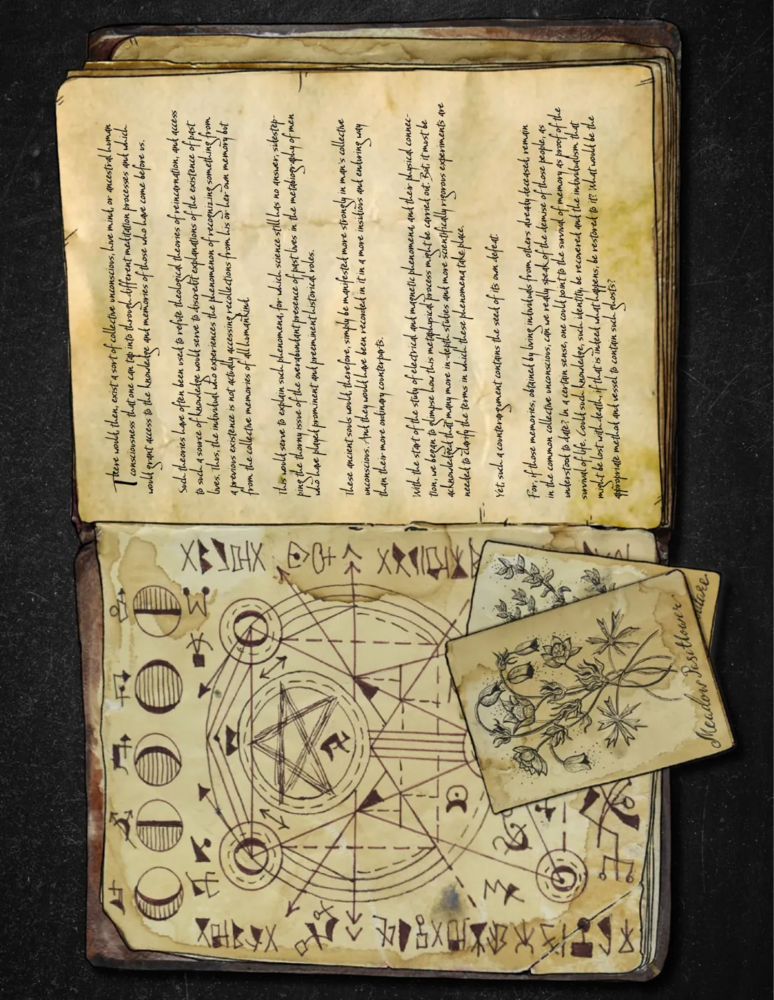

## Раздатка 10. Книга об оккультизме

> **Раздатка 10. Книга об оккультизме**
>
> Существовало бы, таким образом, нечто вроде коллективного бессознательного, роевого разума или наследственного человеческого сознания, к которому можно подключиться с помощью разных медитативных практик и которое дало бы доступ к знаниям и воспоминаниям тех, кто жил до нас.
>
> Такие теории не раз использовались, чтобы опровергнуть богословские учения о перевоплощении, а доступ к подобному источнику знаний служил бы для опровержения объяснений, будто существуют прошлые жизни. Так, человек, переживающий узнавание чего-то из прежнего существования, на самом деле черпает воспоминания не из собственной памяти, а из коллективной памяти всего человечества.
>
> Это объяснило бы явления, на которые у науки пока нет ответа, обойдя щекотливый вопрос об избытке прошлых жизней в метабиографии людей, игравших видные и выдающиеся исторические роли.
>
> Эти древние души, стало быть, просто сильнее проявлялись бы в коллективном бессознательном человека. И запечатлелись бы в нём глубже и прочнее, чем их более заурядные собратья.
>
> С началом изучения электрических и магнитных явлений и их физической связи мы начали понимать, как мог бы осуществляться этот метафизический процесс. Но следует признать, что нужно ещё много углублённых исследований и более научно строгих опытов, чтобы прояснить, на каких условиях происходят эти явления.
>
> Однако такой контрдовод несёт в себе зерно собственного поражения.
>
> Ведь если эти воспоминания, полученные живыми от уже умерших, остаются в общем коллективном бессознательном, можно ли говорить о кончине этих людей в том смысле, как её понимали до сих пор? В каком-то смысле выживание памяти можно счесть доказательством выживания жизни. Можно ли вернуть такое знание, такую личность и восстановить в нём ту индивидуальность, что, возможно, теряется со смертью, если это и впрямь так? Каков был бы подходящий способ и сосуд, чтобы вместить таких призраков?
>
> [на нижней странице — магический круг с пентаграммой, фазами луны и знаками; поверх лежат две карточки с рисунками растений]
