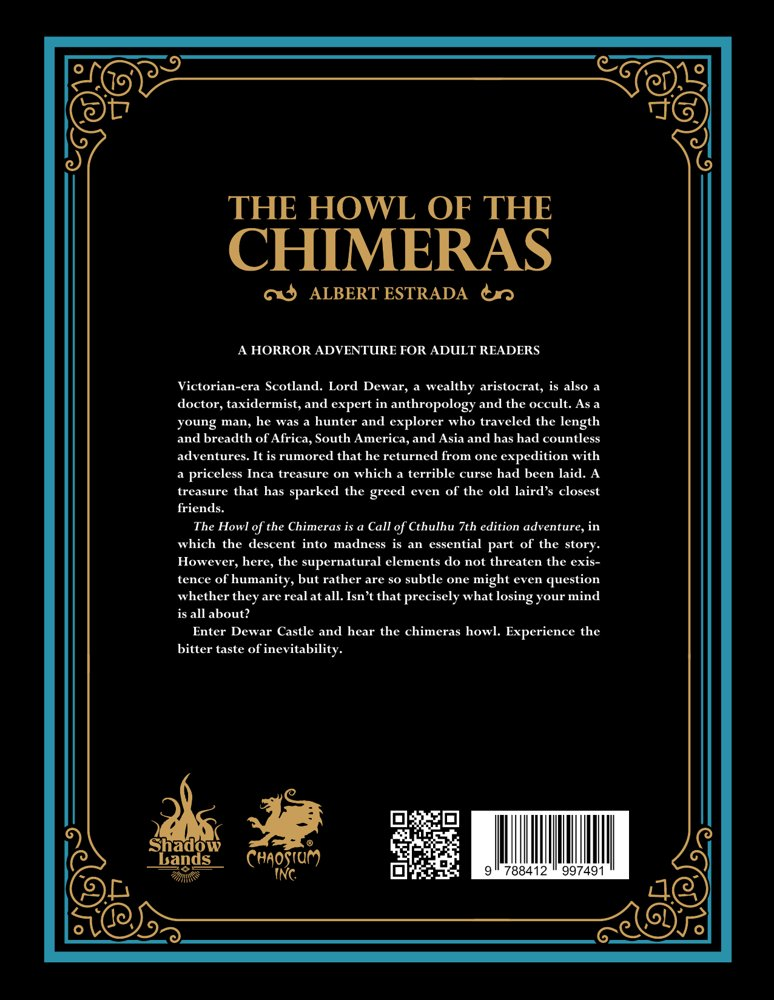

## Задняя обложка

**Вой химер** — Альберт Эстрада

**Хоррор-приключение для взрослых читателей**

Викторианская Шотландия. Лорд Дьюар, богатый аристократ, ещё и врач, таксидермист и знаток антропологии и оккультизма. В молодости он был охотником и исследователем, изъездил вдоль и поперёк Африку, Южную Америку и Азию и пережил бесчисленные приключения. Ходят слухи, что из одной экспедиции он вернулся с бесценным сокровищем инков, на которое наложено страшное проклятие. Сокровищем, которое разожгло алчность даже у самых близких друзей старого лэрда.

«Вой химер» — приключение для седьмой редакции «Зова Ктулху», в котором погружение в безумие — неотъемлемая часть истории. Однако здесь сверхъестественное не угрожает существованию человечества: оно настолько неуловимо, что можно даже усомниться, реально ли оно вообще. Не в этом ли и состоит потеря рассудка?

Войдите в замок Дьюар и услышьте вой химер. Ощутите горький вкус неизбежности.

*Внизу — логотипы Shadowlands и Chaosium, QR-код и штрихкод ISBN.*
