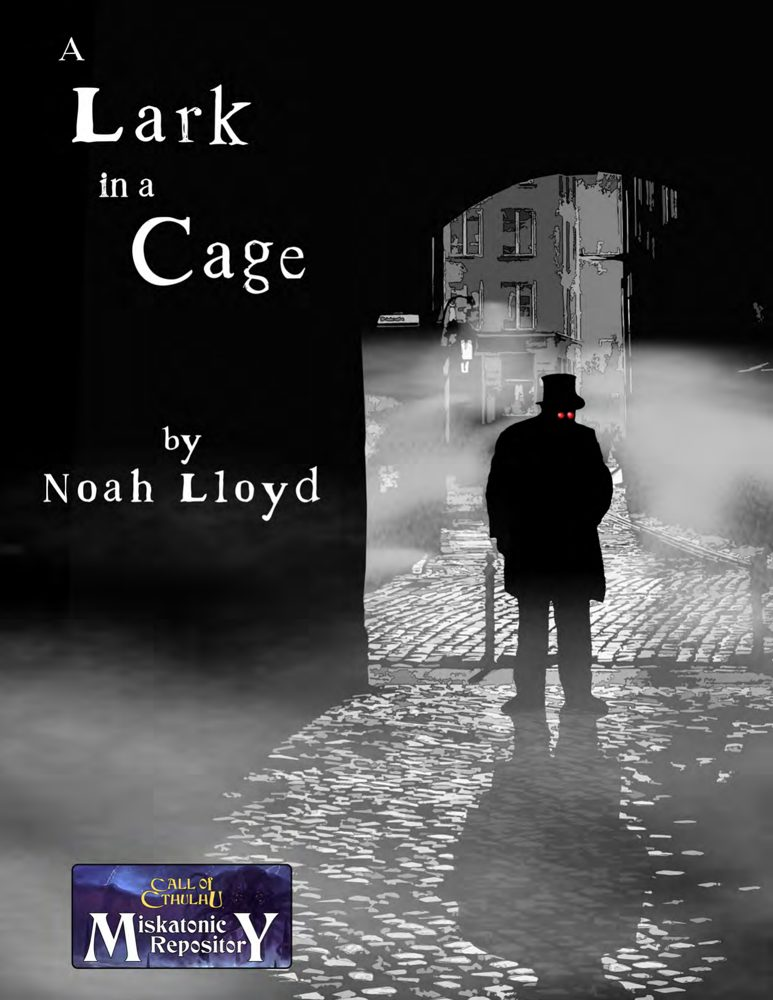

ЖАВОРОНОК В КЛЕТКЕ

Ной Ллойд

*На обложке — силуэт человека в цилиндре и пальто, с горящими красными глазами, на мощёной туманной лондонской улице; слева — название «A Lark in a Cage» и имя автора (by Noah Lloyd), внизу — логотип «Call of Cthulhu — Miskatonic Repository».*
