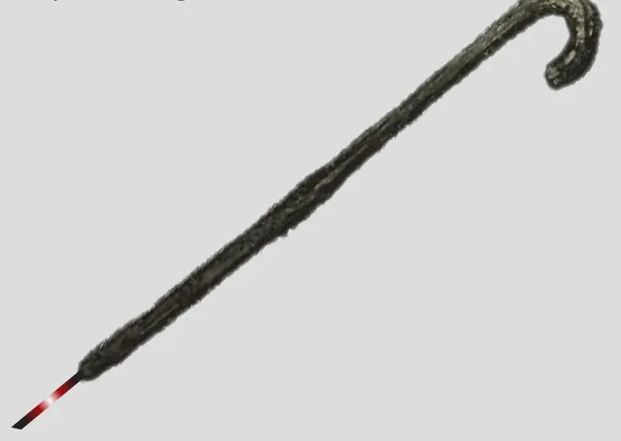

## *Питер Вегг*, полуупырь

Питер — старший брат Генриетты Портер, урождённой Вегг; в конце 1840-х и начале 50-х он работал научным ассистентом у доктора Грейвза. В 1852 году Грейвз ввёл ему сыворотку, которая даровала бессмертие, но и превратила Вегга в полуупыря. Грейвз продолжил опыты и пришил Веггу дополнительные руки возле грудной клетки. Человеческого в Вегге почти не осталось, и подчиняется он только воле своего создателя.

**Внешность:** ростом почти 2,1 м, кожа зеленоватая, похожая на резину. Уши у него отвалились, и на их месте остались лишь отверстия в черепе. Улыбка тянется от одного такого отверстия до другого и открывает полную пасть острых зазубренных зубов.

**Черты:** Вегг послушен Грейвзу; подходящий человек, пожалуй, мог бы его урезонить, но склонность Вегга к насилию делает это маловероятным.

**Как отыгрывать:** Вегг тяжело дышит и обычно прячет лицо под полями большого цилиндра.

## *Семья Портер*, лондонцы, которым не повезло

Готовые сыщики — члены семьи Портер или близко с ней связаны. Если играете этими персонажами, начните с рассказа о том, как недавно изменилось их денежное положение. Сэмпсон Портер, отец Луизы и Реджины, потерял место в полиции после ранения и был вынужден переехать к Луизе и её мужу, Солу Кэхиллу. Вместе с Сэмпсоном переехали Генриетта, мать детей (и сестра Питера Вегга), и Реджина, ещё не покинувшая родительский дом. За Реджиной ухаживает Джордж Маккензи — единственный сыщик, который не живёт в доме Кэхиллов в Дептфорде.

Подробности и описания каждого — в *приложении 4* (с. 45).

# Превращение

После того как на сыщиков нападут в *«Крушении»* (с. 12), любой из них может подвергнуться упыриному превращению от сыворотки Грейвза (или даже несколько, если вы настроены жестоко, — под подозрением каждый, кого уколола трость Вегга). Превращение занимает 12 часов. Чем ближе расследование подбирается к Грейвзу, тем заметнее становятся перемены.

> **Трость Вегга**
>
> Атакуя тростью, Вегг использует следующие показатели, а в *«Крушении»* (с. 12) атакует только ею. По умолчанию в трости две дозы сыворотки Грейвза, но если сыщики сумеют её заполучить, смело меняйте это число.
>
> **Трость:** 65% (32/13), урон 1d3 (без бонуса к урону) плюс укол сыворотки упырей
>
> 

В течение часа проявляются первые симптомы: необычайно мучительный рост — за несколько минут сыщик вырастает на 7–8 см (Рассудок 1/1d3). После этого скачка роста рана от трости Вегга гноится и испускает лиловатые миазмы. К этому времени уже должно быть очевидно, что с сыщиком что-то происходит; если есть сомнения, это подтвердят проверки Медицины или Науки (биология). *Таблица 1: превращение* описывает остальные перемены, которые сыщик претерпит за сутки. Перемены наступают каждые два часа.

Часть превращения похожа на кессонную болезнь — то, что сегодня зовут «бендами», или декомпрессионной болезнью; это подтвердит доктор Фоксвелл (в *«Доме доктора Нолана Фоксвелла»*, с. 13) или трудная проверка Медицины. Единственное настоящее лечение «бендов» — кислород под повышенным давлением, но как средство от декомпрессионной болезни его откроют лишь в 1937 году, поэтому никакие проверки Медицины или Первой помощи на него не укажут.
