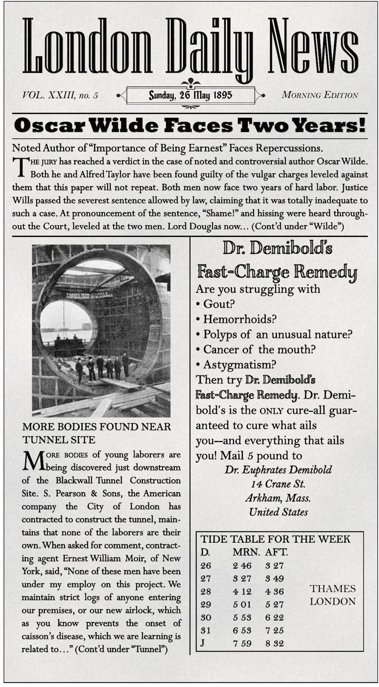

*Раздатка 1: Времена Уайльда*

> **Раздатка 1: Времена Уайльда**
>
> **«Лондон дейли ньюс»**
>
> Т. XXIII, № 5 — воскресенье, 26 мая 1895 года — УТРЕННИЙ ВЫПУСК
>
> **Оскару Уайльду грозят два года!**
>
> *Известный автор «Как важно быть серьёзным» пожинает плоды.*
>
> ПРИСЯЖНЫЕ вынесли вердикт по делу известного и скандального писателя Оскара Уайльда. И он, и Альфред Тейлор признаны виновными по непристойным обвинениям, которые наша газета повторять не станет. Обоим теперь грозят два года каторжных работ. Судья Уиллс вынес самый суровый приговор, какой допускает закон, заявив, что для подобного дела он совершенно недостаточен. При оглашении приговора по залу суда раздались крики «Позор!» и шиканье в адрес обоих. Лорд Дуглас теперь… (Продолжение под рубрикой «Уайльд»)
>
> *[Фотография: огромное круглое кольцо тоннельного щита, перед ним — рабочие.]*
>
> **НОВЫЕ ТЕЛА У СТРОЙКИ ТОННЕЛЯ**
>
> НОВЫЕ ТЕЛА молодых рабочих находят чуть ниже по течению от строительства Блэкуоллского тоннеля. «С. Пирсон и сыновья», американская компания, которой город Лондон поручил строительство тоннеля, утверждает, что ни один из этих рабочих у неё не служил. На просьбу о комментарии подрядный агент Эрнест Уильям Мойр из Нью-Йорка сказал: «Ни один из этих людей не работал у меня на этом проекте. Мы ведём строгий учёт всех, кто входит на нашу территорию или в наш новый шлюз, который, как вам известно, предотвращает кессонную болезнь, связанную, как мы теперь узнаём, с…» (Продолжение под рубрикой «Тоннель»)
>
> **Чудодейственное средство доктора Демиболда**
>
> Вас мучают
>
> • Подагра? 
> • Геморрой? 
> • Полипы необычного свойства? 
> • Рак рта? 
> • Астигматизм?
>
> Тогда попробуйте Чудодейственное средство доктора Демиболда. Средство доктора Демиболда — ЕДИНСТВЕННОЕ универсальное лекарство, которое гарантированно излечит то, что вас мучает, — и всё остальное, что вас мучает! Вышлите 5 фунтов по адресу:
>
> *Доктор Юфратес Демиболд, Крейн-стрит, 14, Аркхэм, Массачусетс, Соединённые Штаты*
>
> | ТАБЛИЦА ПРИЛИВОВ НА НЕДЕЛЮ (ТЕМЗА, ЛОНДОН) — день | Утро | День |
> |---|---|---|
> | 26 | 2 46 | 3 27 |
> | 27 | 3 27 | 3 49 |
> | 28 | 4 12 | 4 36 |
> | 29 | 5 01 | 5 27 |
> | 30 | 5 53 | 6 22 |
> | 31 | 6 53 | 7 25 |
> | И (1 июня) | 7 59 | 8 32 |

*Прим. перев.: в газете «С. Пирсон и сыновья» названа американской компанией, а в тексте сценария — британской строительной фирмой (какой она и была). «J» в последней строке таблицы приливов — вероятно, June (1 июня).*
