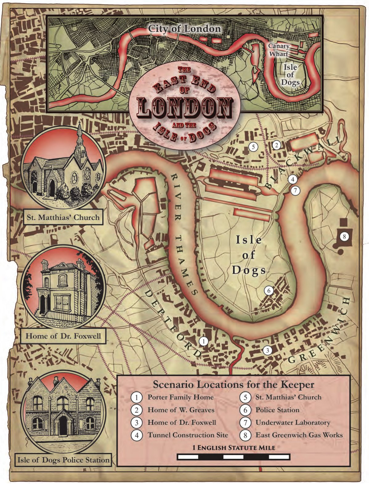

## Ист-Энд Лондона: карта Хранителя

*Надписи карты: «The East End of London and the Isle of Dogs» — Ист-Энд Лондона и Собачий остров; на врезке-обзоре — City of London (Сити), Canary Wharf (Канэри-Уорф), Isle of Dogs (Собачий остров); на карте — River Thames (Темза), Isle of Dogs, Deptford (Дептфорд), Blackwall (Блэкуолл), Greenwich (Гринвич). Виньетки слева: St. Matthias’ Church — церковь Святого Матфия; Home of Dr. Foxwell — дом доктора Фоксвелла; Isle of Dogs Police Station — полицейский участок Собачьего острова. Масштаб: 1 English Statute Mile — 1 английская миля (1,6 км).*

**Места сценария для Хранителя**

| № | На карте | Что это |
|---|---|---|
| 1 | Porter Family Home | дом семьи Портер (дом Кэхиллов) |
| 2 | Home of W. Greaves | дом У. Грейвза |
| 3 | Home of Dr. Foxwell | дом доктора Фоксвелла |
| 4 | Tunnel Construction Site | строительство Блэкуоллского тоннеля |
| 5 | St. Matthias’ Church | церковь Святого Матфия |
| 6 | Police Station | полицейский участок Собачьего острова |
| 7 | Underwater Laboratory | подводная лаборатория Грейвза |
| 8 | East Greenwich Gas Works | Восточно-Гринвичский газовый завод |
