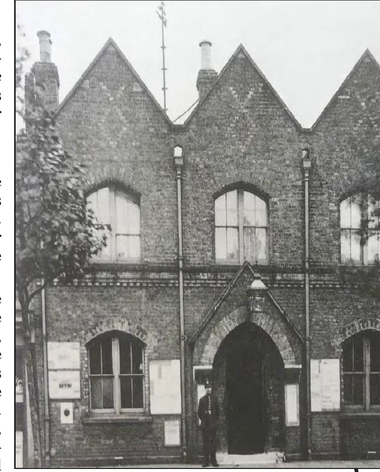

## Полицейский участок Собачьего острова

Полицейский участок Собачьего острова (его служащих часто зовут островной или речной полицией) — красное кирпичное здание с островерхими крышами на Манчестер-стрит, на Собачьем острове, к северу от Темзы. Сыщикам, возможно, придётся напомнить, что одна из главных причин прийти сюда — найти Фланагана, и для этого, увы, может понадобиться заглянуть в морг.

На Собачьем острове сыщики будут иметь дело прежде всего с **сержантом Джеймсом Колбертом** (возможно, они уже встретили его на *Восточно-Гринвичском газовом заводе*, с. 16). Колберт — крепкий полицейский средних лет, служащий в столичной полиции с шестнадцати лет. Попасть к нему просто, если сыщики заявят, что у них есть новые важные сведения. Иначе им придётся уговорить секретаря — младшего чина — пропустить их. Разрешайте только трудные проверки общения (**Обаяние**, **Убеждение** и т. п.): участок Собачьего острова — место людное. Если сыщики решат, что лучше всего поднять шум, Колберт выйдет посмотреть, что происходит; но если сыщики выбросят хоть один провал, полиция охотно выставит их за порог или запрёт до утра за «бродяжничество». Карточка доктора Фоксвелла для доктора Кросса облегчает дело, но, если злить полицию, сыщиков всё равно могут вышвырнуть на улицу.

- Если показать Колберту подкидыша или спросить об исчезновениях детей, ничего ценного он не знает. С **Обаянием** или **Убеждением** он сочувствует (хоть и не понимает, в чём дело), но говорит, что должен заниматься своими текущими делами, тем более что с ребёнком, похоже, всё в порядке.
- Колберт не скрывает, что в последнее время в Темзе находят слишком много тел. Несмотря на недавнюю волну явных утоплений и «несчастных случаев с гребными винтами», как их называет островная полиция, ни одно из остальных тел никто в городе не опознал и не забрал. (Это бездомные — жертвы доктора Грейвза.)
- Если спросить, откуда берутся тела, Колберт подчёркивает, что, хотя *строительство Блэкуоллского тоннеля* (с. 27) рядом, там ведут очень тщательный учёт, и никто из рабочих не пропадал.
- Если сыщики спросят и пройдут проверку **Убеждения**, Колберт скажет, что дело о раздавленном кучере «виктории» из *«Крушения»* (с. 12) закрыто как «смерть от несчастного случая».
- О Рэймонде Фланагане Колберт ничего не слышал.
- Чтобы без карточки доктора Кросса уговорить Колберта показать сыщикам тела, нужна трудная проверка **Убеждения**, трудная проверка **Обаяния** или проверка **Красноречия**. При успехе Колберт предупредит сыщиков: «Зрелище то ещё».
