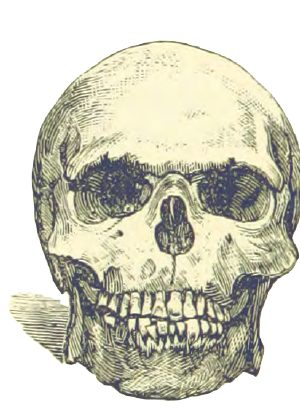

### Допрос Картрайта

Совесть тяжко давит на Картрайта. С **Запугиванием** или **Красноречием** (упоминание украденного младенца даёт бонусную кость) Картрайт заливается слезами и выкладывает всё, что знает, — кроме вести о формуле бессмертия: её он ни при каких обстоятельствах никому не выдаст.

- Под церковью Святого Матфия живут по меньшей мере дюжина странных существ — похожих на людей, но других. «По-моему, они людоеды».
- К нему обратился некий «доктор Грейвз», который хотел ставить опыты на этих существах; он платит Картрайту, чтобы тот следил за их передвижениями.
- Под **Запугиванием** Картрайт признаётся, что когда-то Грейвз с помощью подручного («чудище, а не человек, ростом за два метра, зубы как бритвы, кожа мёртвая, как у старой рыбы») похищал существ прямо из цистерны, но те, похоже, раскусили эту уловку.
- Если прямо спросить его при успешном **Обаянии**, **Убеждении** или подобном, Картрайт признаётся, что видел существ в цистерне, которая соединяется с остальной лондонской канализацией. От этого признания он ломается от страха и раскаяния. «Их дети, — говорит он, — их дети — сущее дьявольское отродье».
- Картрайт не раз видел, как упыри возвращаются, неся на руках что-то маленькое и завёрнутое. При трудной проверке **Убеждения** или **Запугивания** он признаётся, что однажды слышал, как один из таких свёртков плакал, словно младенец.

Хотя Картрайт в ужасе и от упырей, и от того, что позволил случиться, он по-прежнему одержим мечтой о бессмертии и хочет убрать сыщиков с этого пути. Он охотно ведёт их в катакомбы и закрывает за ними дверь склепа — тяжёлую, каменную — и запирает её на засов снаружи. В этом случае единственный выход — через *цистерну* (с. 21) в *лондонскую канализацию* (с. 23).

## Катакомбы под церковью Святого Матфия

Поведёт ли сыщиков в катакомбы Макинтош или их запрёт там Картрайт, найдут они ничем не примечательные останки нескольких сотен давних лондонских прихожан — кости, сложенные аккуратными рядами. Таблички на полках указывают, когда полки поставили. Самая поздняя гласит «1805», но чем дальше идут сыщики, тем дальше в прошлое уходят даты: «1792», «1746», «1656», «1541». С проверкой **Истории** сыщики вспоминают, что церковь построена в 1640-х годах, а значит, катакомбы намного старше церкви.

Сыщикам в темноте нужен какой-нибудь свет. Если Картрайт запер их внутри и никто не догадался взять свечу или фонарь, позвольте изобретательным решениям сработать: из лоскутов ткани и костей можно сделать самодельные факелы и т. п. (Карманный электрический фонарик изобретут через четыре года, в 1899-м. Почти любой мужчина в 1890-х носит спички, чтобы прикуривать, но, если хотите сильнее надавить на сыщиков, можете потребовать проверки **Удачи**.)

В конце концов сыщики упираются в тупик. **Внимание** на полу, где пыль копилась веками, замечает свежие следы и большую дугу, прочерченную в пыли и ведущую к одной из стен. Ещё одна проверка **Ориентирования** или **Чтения следов** показывает, что одна пара следов — босая; трудная проверка **Чтения следов** или трудная проверка **Науки (биология)** устанавливает, что с этими следами что-то не так — в них есть что-то нечеловеческое. Другие следы оставлены мужскими ботинками, которые будто бы уходят прямо сквозь стену и возвращаются — возможно, на обратном пути с чем-то тяжёлым; эти следы, похоже, на несколько недель старше.
