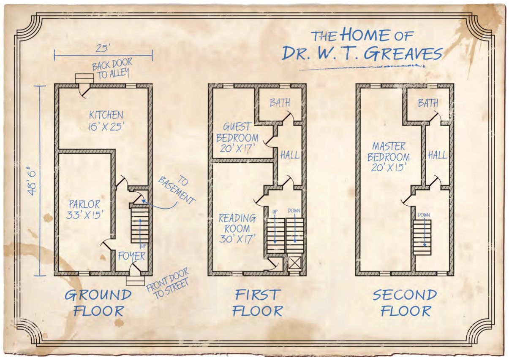

*Надписи плана: «The Home of Dr. W. T. Greaves» — дом доктора У. Т. Грейвза. Ground Floor (первый этаж): Back door to alley — задняя дверь в переулок; Kitchen 16′ × 25′ — кухня, около 5 × 8 м; Parlor 33′ × 15′ — гостиная, около 10 × 5 м; Foyer — прихожая; Front door to street — парадная дверь на улицу; To basement — в подвал. First Floor (второй этаж): Guest bedroom 20′ × 17′ — гостевая спальня, около 7 × 6 м; Bath — ванная; Hall — коридор; Reading room 30′ × 17′ — читальня, около 10 × 6 м. Second Floor (третий этаж): Master bedroom 20′ × 13′ — хозяйская спальня, около 7 × 4 м; Bath — ванная; Hall — коридор. Общие размеры дома — 25′ × 48′6″ (около 8 × 15 м).*

Запертая дверь под лестницей (её открывают **Взломом** или трудной проверкой **СИЛ**) ведёт в бывшую кладовую, но теперь в её полу пробита дыра, которая ведёт в **подвал**.

**Второй этаж:** с виду гостевая спальня, где иногда ночует Питер Вегг, влезая через заднее окно второго этажа. Кровать заправлена, но если кто-нибудь догадается откинуть покрывало, между нижней и верхней простынёй окажется тонкая плёнка жира. Кроме того, к простыням пристали хлопья плесени, похожей на плесень из *морга* (с. 18). **Внимание** замечает на ковре грязные следы сапог и горсть прокомпостированных билетов Гринвичской железной дороги, засунутых под кровать. Ещё здесь есть маленькая читальня с единственным книжным шкафом, где **Работа в библиотеке** замечает явное отсутствие медицинских книг у человека, который называет себя доктором, и маленькая ванная.

**Третий этаж:** ещё одна ванная, где нет ничего интересного, и собственная спальня Грейвза, которой он редко пользуется: платяной шкаф, комод, ночной столик и кровать. Видно, что спальней не пользуются. В шкафу единственный запасной костюм и зимнее пальто, а в комоде — одна пара носков: это явно смена одежды, а не модный гардероб богача. При **Внимании** в спальне Грейвза или если кто-то прямо скажет, что осматривает ночной столик, сыщики находят фотографию гораздо более молодого Уэйнрайта Грейвза, лет 35, рядом с мужчиной ещё моложе — лет двадцати пяти. Чрезвычайный успех проверки **Идеи** узнаёт в молодом человеке человеческий облик существа, напавшего на сыщиков вскоре после встречи с Амелией, в *«Крушении»* (с. 12). Если открыть рамку, на обороте фотографии тонким карандашом нацарапано: «Уэйнрайт Грейвз и Питер Вегг, 1852».

> **Портеры узнают Питера**
>
> Если играете готовыми сыщиками, любой из старших супругов (Сэмпсон и Генриетта) узнаёт в молодом человеке на фотографии старшего брата Генриетты, Питера, каким он был незадолго до того, как пропал. Это, конечно, тот самый Питер Вегг, которого Грейвз вскоре погубит, превратив в чудовищного полуупыря Питера Вегга 1895 года. Когда сыщики сообразят, что напавшее на них чудовище — брат Генриетты, попросите проверки **Рассудка**. Потеря — 1/1d4 у всех, кроме Генриетты, у которой 2/1d6.
