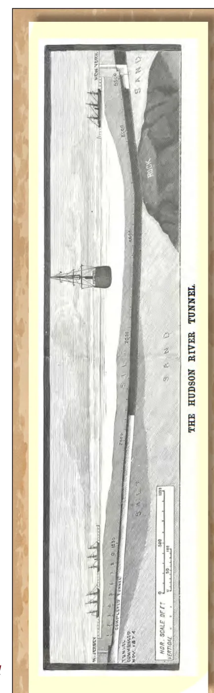

**Подвал:** тесный и грязный, вырыт прямо в голубоватой лондонской глине; открытые медные трубы порой гремят, когда кто-то из соседей спускает воду в уборной. Проверки **Архитектуры** или **Механики** показывают, что подвал явно пристроен к дому позже; на земляном полу стоит вода глубиной в несколько сантиметров. В южной стене вырыта большая дыра, вокруг входа в неё — кучи земли. Через пару метров дыра выводит в тоннели более правильной ширины: **Внимание** замечает по всей длине этих тоннелей следы пальцев в глине, будто их рыли руками (**Рассудок** 0/1d2). (Это та территория, о потере которой жалуются упыри в *цистерне*, с. 21.)

Тоннели петляют и запутаны, но на всех главных развилках Грейвз нарисовал белые стрелки. Если сыщики спускаются в тоннели со светом, идти по стрелкам легко; без света нужна трудная проверка **Внимания**, чтобы заметить первую стрелку. Стрелки приводят к ещё одной дыре — на середине лестницы в шахте, ведущей к *подводной лаборатории Грейвза* (с. 28). (Если сыщики заблудятся или нарочно сойдут с пути, проверки **Ориентирования** или **Выживания** выводят их в канализацию, где ближайший люк открывается возле *строительства Блэкуоллского тоннеля*.)

## Строительство Блэкуоллского тоннеля

Строительство Блэкуоллского тоннеля идёт на обоих берегах Темзы: на юго-востоке — Гринвичский полуостров, на северо-западе — попларский квартал Блэкуолл. Здесь бригады британской строительной фирмы «С. Пирсон и сыновья» прокладывают тоннель под Темзой. Ночью стройка пуста, но если сыщики придут днём, они могут встретить **Эрнеста Уильяма Мойра**, главного подрядчика «С. Пирсон и сыновья» в Англии. О подводной лаборатории Грейвза Мойр ничего не знает, но обычная проверка **Убеждения** или **Обаяния** заставит его рассказать, что Грейвз — видный жертвователь проекта. Мойр твёрдо стоит на том, что ни один из его рабочих со стройки не пропадал, — более того, он с радостью покажет сыщикам улучшения безопасности, которые ввёл для подземного строительства, в том числе камеру-«шлюз».

На проходке тоннеля применяют и недавно изобретённое защитное устройство для рабочих — щит Грейтхеда, созданный неким Джеймсом Генри Грейтхедом. Щит — это стальной цилиндр с полом для рабочих: они выбирают грунт по другую сторону цилиндра и передают его назад, а другие рабочие позади щита ставят крепь, чтобы тоннель не обрушился (впрочем, в очень плотной лондонской глине это заботит меньше).

У края стройки стоит ветхий сарай для инструментов с приоткрытой дверью. В дальнем углу, за рядами кирок и другого снаряжения, спрятан ещё один вход в *подводную лабораторию Грейвза* (с. 28). Вделанный в пол зелёный люк можно открыть **Взломом** или чрезвычайной проверкой **СИЛ** (с бонусной костью, если помогает ещё один сыщик или есть инструмент вроде лома).

*Раздатка 5: Гудзонский тоннель*

> **Раздатка 5: Гудзонский тоннель**
>
> *Рисунок продольного разреза тоннеля под рекой между Нью-Джерси и Нью-Йорком; над водой — корабли.*
>
> **ГУДЗОНСКИЙ ТОННЕЛЬ**
