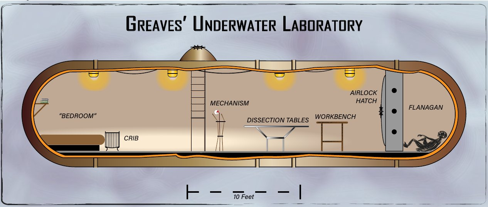

Под люком лестница уходит в тёмную шахту. Если сыщики приходят сюда днём, бродить по стройке им не дают, но успешная групповая проверка **Удачи**, а за ней трудная проверка **Внимания** всё же могут заметить люк. Если сыщики преследуют Вегга от *дома Уэйнрайта Таморы Грейвза* (с. 24), к люку их приведут успешные проверки **Слуха** и/или **Чтения следов**.

### Шлюз

Мойр создал свой шлюз, чтобы уберечь рабочих от кессонной болезни («бендов»). Впервые применив его на проходке тоннеля под Гудзоном в Нью-Йорке, Мойр перенёс устройство на строительство Блэкуоллского тоннеля, и теперь камера (почти всегда) безопасно возвращает рабочих к обычному давлению, когда они поднимаются наверх. На этой стройке кессонной болезни заметно меньше, но совсем избавиться от неё шлюз не смог. Шлюз — ключ к спасению и исцелению превращающегося сыщика (см. *«Лекарство»*, с. 8), а также Рэймонда Фланагана, которого можно найти в *подводной лаборатории Грейвза* (с. 28).

Чтобы попасть в тоннель, вагонетки и оборудование грузят на открытую подъёмную платформу (рабочие спускаются по соседней лестнице), которая опускается на 15 м, до дна тоннеля, и проходят в открытую дверь (это и есть шлюз). За рабочими и оборудованием эту дверь закрывают и открывают следующую, так что по ту сторону, в самом тоннеле, держится постоянное давление. Если когда-нибудь открыть обе двери разом (а не сбрасывать давление постепенно, как делают рабочие в конце дня), весьма вероятна стремительная взрывная декомпрессия.

## Подводная лаборатория Грейвза

### Как попасть в лабораторию

Главный путь в лабораторию — тоннели из подвала *дома Уэйнрайта Таморы Грейвза*. Сыщики могут попасть сюда и через запасную шахту с поверхности, выходящую в сарай для инструментов на *строительстве Блэкуоллского тоннеля* (с. 27). На середине шахты большая дыра ведёт обратно в тоннели, соединённые с *домом Уэйнрайта Таморы Грейвза* (с. 24).

Лестница уходит ещё на 12 м вниз, к тоннелю, похожему на тоннели в подвале *дома Уэйнрайта Таморы Грейвза* (с. 24): примерно 1,2 на 1,2 м, со следами когтей в глине — ими его явно и рыли. Метров через тридцать (**Выживание** или **Ориентирование** подсказывают, что сыщики теперь под Темзой) тоннель упирается в две железные двери, одну за другой. Естественного света в этих подземельях нет.

*Надписи разреза: «Greaves’ Underwater Laboratory» — подводная лаборатория Грейвза; “Bedroom” — «спальня»; Crib — колыбель; Mechanism — механизм (пульт управления); Dissection tables — столы для вскрытий; Workbench — верстак; Airlock hatch — люк шлюза; Flanagan — Фланаган. Масштаб: 10 Feet — 3 м.*
