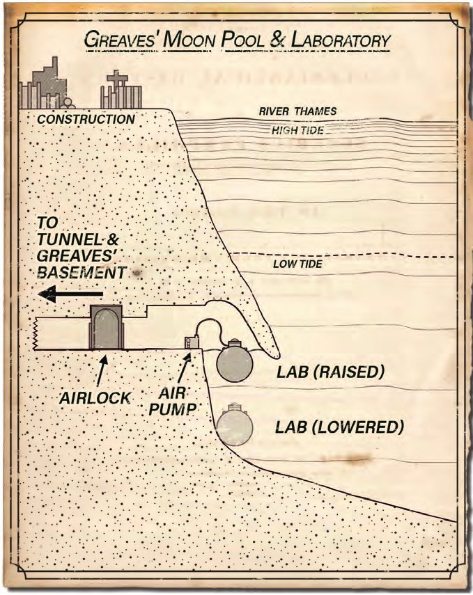

*Надписи разреза: «Greaves’ Moon Pool & Laboratory» — лунный колодец и лаборатория Грейвза; Construction — стройка; River Thames — Темза; High tide — уровень прилива; Low tide — уровень отлива; To tunnel & Greaves’ basement — к тоннелю и подвалу Грейвза; Airlock — шлюз; Air pump — воздушный насос; Lab (raised) — лаборатория всплыла; Lab (lowered) — лаборатория погружена.*

Если открыть наружную дверь, закрыть её, а затем открыть внутреннюю, попадаешь в небольшую камеру — 3 м по стороне, 2 м высотой, обшитую железом. Дальняя сторона камеры выходит к небольшому лунному колодцу, где может всплывать верхний люк подводного аппарата Грейвза. Железные двери образуют шлюз, поддерживая в камере давление, достаточное, чтобы её не залила Темза. Когда одна из двух дверей открыта, чтобы открыть вторую, нужна чрезвычайная проверка **СИЛ**; если же обе двери откроются разом, Темза немедленно хлынет в камеру и всего за два раунда заполнит её до самой вертикальной шахты.

Если сыщики приходят ночью, Грейвз в своей лаборатории, а лунный колодец пуст — мутная тёмная вода лижет стены камеры. Если они приходят днём, когда Грейвз дома, верхний люк подводного аппарата торчит из воды — виден, но закрыт и пришвартован к двум уткам, вделанным в стены. Для подачи воздуха в аппарат приспособлен автомобильный двигатель; его назначение распознают **Механика**, **Управление тяжёлыми машинами** или трудная проверка **ОБР**. От него к лаборатории тянутся два толстых чёрных шланга, и если лаборатория погружена, то, перерезав или пережав любой из шлангов, сыщики заставят Грейвза всплыть, пока он не задохнулся.

### Сама лаборатория

Лаборатория Грейвза — по сути, очень большой герметичный водолазный колокол, способный лишь опускаться и подниматься по вертикали; с его помощью Грейвз меняет давление во время опытов.

Когда люк открывают, оттуда вырывается воздух, смердящий гнилью, и все, кроме превращающегося сыщика, проходят проверку **ВЫН** (у превращающегося сыщика, напротив, текут слюнки). При провале — тошнота и рвота, но без иного урона. Проверки **Науки** или **ОБР** подсказывают, что это подводный аппарат, но маленький лунный колодец открывает слишком мало, чтобы угадать его размер.

Открыть люк просто — штурвальный запор есть с обеих сторон, — и спуститься в аппарат легко. Люк чуть позади середины корпуса: от него около 3 м в корму и ещё около 10 м в нос. Внутри аппарат освещают резкие электрические лампы, которые зажигает простой выключатель у люка. По всей длине, от кормы до носа, посередине идут решётчатые мостки.

В самой корме Грейвз устроил себе вторую спальню — видимо, запах гнили и тлена его больше не тревожит, — и ею явно пользуются куда чаще, чем спальней в его доме в Блэкуолле. Над огромной кроватью — полка с фотографиями давно умерших родственников, а на кровати разбросано несколько книг с закладками во многих местах. **Работа в библиотеке** находит **раздатку 6: дневник Уэйнрайта Таморы Грейвза**, несколько медицинских книг вроде тех, что сыщики могли видеть у доктора Фоксвелла, и тонкий экземпляр «Герцогини Мальфи» (**раздатка 7: Жаворонок в клетке**).
