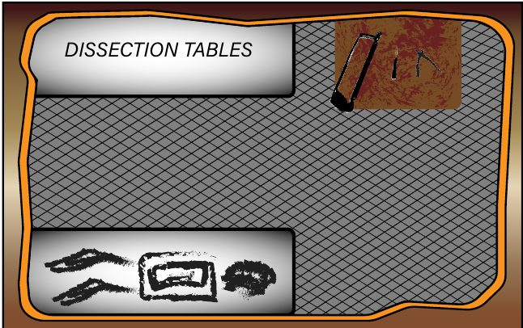

*Надпись на рисунке: «Dissection Tables» — столы для вскрытий.*

Стоит Фланагану снова оказаться при обычном атмосферном давлении — то есть когда открывают дверь в камеру шлюза, — его здоровье начинает угасать. У сыщиков есть один час, чтобы спасти его, доставив в шлюз на *строительстве Блэкуоллского тоннеля* (с. 27).

### Книга Мифов: дневник Уэйнрайта Таморы Грейвза

*Английский язык, доктор Уэйнрайт Грейвз, 1851–1895*

Переплетённый в кожу журнал, исписанный убористым педантичным почерком; этот толстый дневник описывает сорок лет опытов над лондонскими бездомными, а также над лондонскими упырями. Грейвз описывает (и зарисовывает), как ампутировать конечности бездомных и пришивать их к телам упырей, пересаживать органы и насильно кормить (опять же бездомных) мясом упырей.

Самые ранние записи рассказывают о создании сыворотки, которая, как надеется Грейвз, дарует ему вечную жизнь; испытав её на своём лаборанте Питере Вегге, он находит результат неудовлетворительным. Следующие несколько десятилетий уходят на попытки улучшить сыворотку — почти или совсем безуспешно. Его последний прорыв касается воздействия чрезвычайного давления на подопытных, и он считает, что ключ может быть во *внезапной резкой декомпрессии*, которая его лаборатории не под силу.

**Потеря Рассудка:** 1d8

**Мифы Ктулху:** +3/+7 процентов

**Значение Мифов:** 9 (25 для всего, что касается упырей)

**Изучение:** 1 неделя

**Рекомендуемые заклинания:** нет.

# Как вести финал

Когда сыщики доберутся до подводного аппарата, сценарий должен быть уже на пике накала: по меньшей мере у одного сыщика превращение достигает высшей точки, Фланаган начинает умирать у них на руках, и им предстоит ещё одна встреча с Веггом.

Как сложится развязка, зависит от того, где сыщики впервые встретят Грейвза и как с ним обойдутся. Чаще всего Вегг нападает на них на *строительстве Блэкуоллского тоннеля* (с. 27).

- Если на Грейвза нападут у него *дома* (с. 24), Вегг бросается ему на выручку. Если Грейвза убьют, Вегг бежит в подвал, к *подводной лаборатории Грейвза* (с. 28), или, если путь отрезан, на улицу. В лабораторию Вегг не входит, а бежит наверх и снова нападёт на сыщиков, если те доберутся до шлюза на *строительстве Блэкуоллского тоннеля*.
- Если Грейвза схватят или убьют в *лаборатории* (с. 28), Вегг нападает, когда сыщики входят в шлюз на *строительстве Блэкуоллского тоннеля*.

## Путь к шлюзу

Чтобы спасти Фланагана и меняющегося товарища, сыщики должны добраться до шлюза на *строительстве Блэкуоллского тоннеля* (с. 27), ведущего вниз, в строящиеся тоннели. Когда они спустятся на подъёмнике или по лестнице и как раз доберутся до шлюза, появляется Вегг, готовый убить всякого сыщика, который останется снаружи камеры давления. (Подробнее о том, как работает исцеление, см. *«Лекарство»*, с. 8.)
