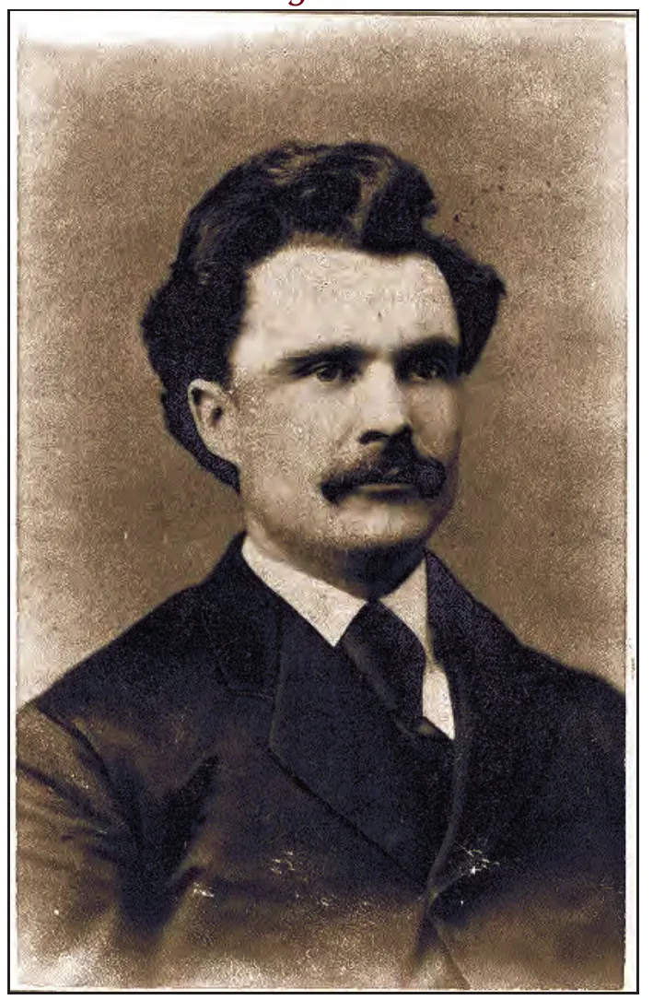
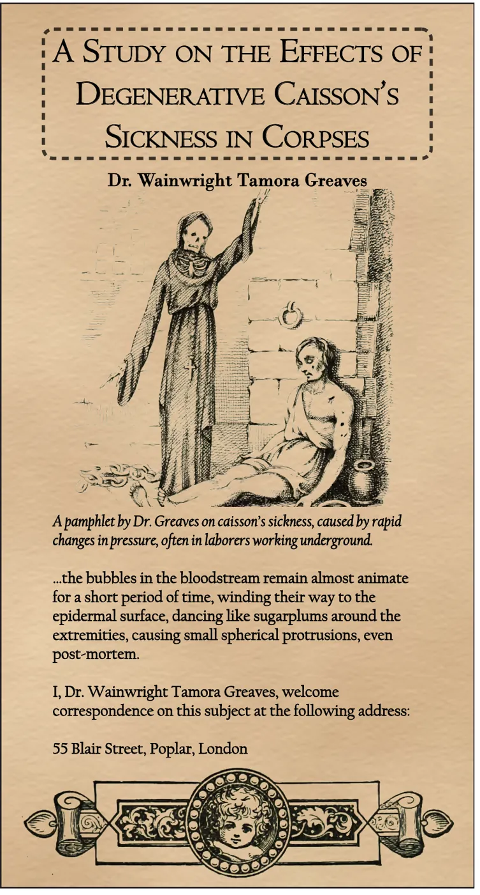

## Раздатка 2: Фланаган

> **Раздатка 2: Фланаган**
>
> *Фотография в тонах сепии: красивый темноволосый мужчина с пышной шевелюрой и густыми усами, в тёмном костюме. Надписей нет.*

<!-- -->

## Раздатка 3: Исследование последствий дегенеративной кессонной болезни у трупов

> **Раздатка 3: Исследование последствий дегенеративной кессонной болезни у трупов**
>
> **ИССЛЕДОВАНИЕ ПОСЛЕДСТВИЙ ДЕГЕНЕРАТИВНОЙ КЕССОННОЙ БОЛЕЗНИ У ТРУПОВ**
>
> *Доктор Уэйнрайт Тамора Грейвз*
>
> *[Гравюра: женщина в балахоне стоит над сидящим у стены изнурённым человеком.]*
>
> *Брошюра доктора Грейвза о кессонной болезни, вызванной резкими перепадами давления, — нередко у рабочих, занятых под землёй.*
>
> …пузырьки в кровотоке ещё недолгое время остаются почти живыми: они пробираются к поверхности эпидермиса, пляшут, как засахаренные сливы, вокруг конечностей и образуют маленькие шарообразные выпуклости — даже после смерти.
>
> Я, доктор Уэйнрайт Тамора Грейвз, буду рад переписке на эту тему по следующему адресу:
>
> Блэр-стрит, 55, Поплар, Лондон
