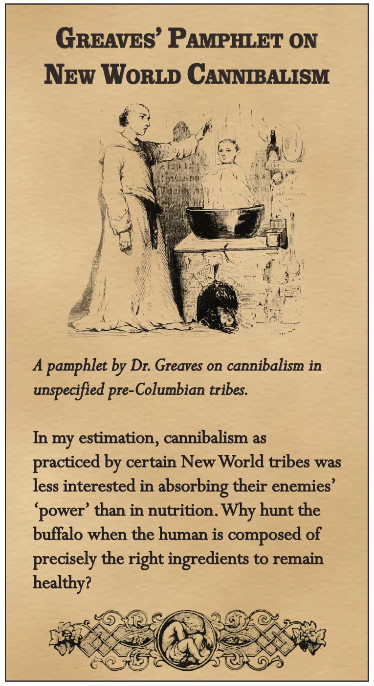
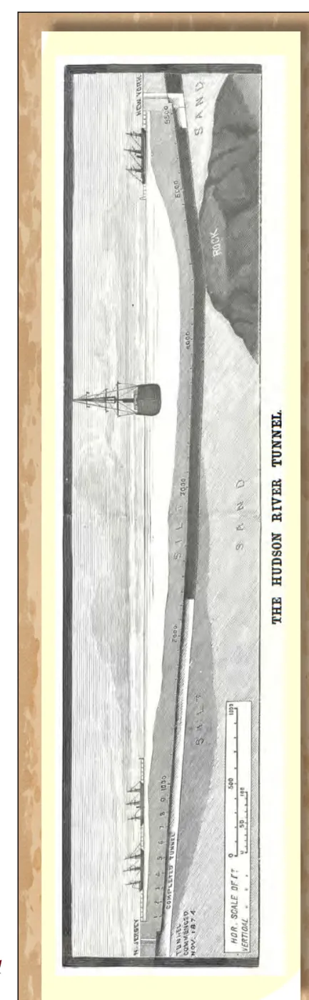

## Раздатка 4: Брошюра о каннибализме в Новом Свете

> **Раздатка 4: Брошюра о каннибализме в Новом Свете**
>
> **БРОШЮРА ГРЕЙВЗА О КАННИБАЛИЗМЕ В НОВОМ СВЕТЕ**
>
> *[Гравюра: монах стоит у большого котла на огне, рядом — ребёнок.]*
>
> *Брошюра доктора Грейвза о каннибализме у неназванных доколумбовых племён.*
>
> По моей оценке, каннибализм, как его практиковали некоторые племена Нового Света, был нацелен не столько на поглощение «силы» врагов, сколько на питание. Зачем охотиться на бизона, если человек состоит ровно из тех веществ, что нужны для здоровья?

<!-- -->

## Раздатка 5: Гудзонский тоннель

> **Раздатка 5: Гудзонский тоннель**
>
> *Рисунок продольного разреза тоннеля под рекой между Нью-Джерси и Нью-Йорком; над водой — корабли. В книге рисунок напечатан повёрнутым на 90°.*
>
> **ГУДЗОНСКИЙ ТОННЕЛЬ**
