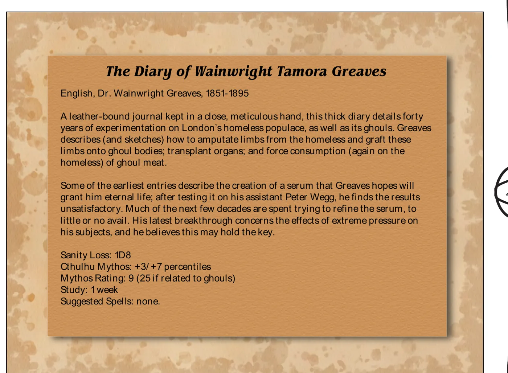

## Раздатка 6: книга Мифов — дневник Уэйнрайта Таморы Грейвза

> **Раздатка 6: Дневник Уэйнрайта Таморы Грейвза**
>
> **Дневник Уэйнрайта Таморы Грейвза**
>
> *Английский язык, доктор Уэйнрайт Грейвз, 1851–1895*
>
> Переплетённый в кожу журнал, исписанный убористым педантичным почерком; этот толстый дневник описывает сорок лет опытов над лондонскими бездомными, а также над лондонскими упырями. Грейвз описывает (и зарисовывает), как ампутировать конечности бездомных и пришивать их к телам упырей, пересаживать органы и насильно кормить (опять же бездомных) мясом упырей.
>
> Самые ранние записи рассказывают о создании сыворотки, которая, как надеется Грейвз, дарует ему вечную жизнь; испытав её на своём лаборанте Питере Вегге, он находит результат неудовлетворительным. Следующие несколько десятилетий уходят на попытки улучшить сыворотку — почти или совсем безуспешно. Его последний прорыв касается воздействия чрезвычайного давления на подопытных, и он считает, что ключ может быть в этом.
>
> Потеря Рассудка: 1d8 
> Мифы Ктулху: +3/+7 процентов 
> Значение Мифов: 9 (25 для всего, что касается упырей) 
> Изучение: 1 неделя 
> Рекомендуемые заклинания: нет.

*Прим. перев.: последняя фраза раздатки короче, чем в тексте сценария (с. 31): там Грейвз считает ключом «внезапную резкую декомпрессию, которая его лаборатории не под силу».*
