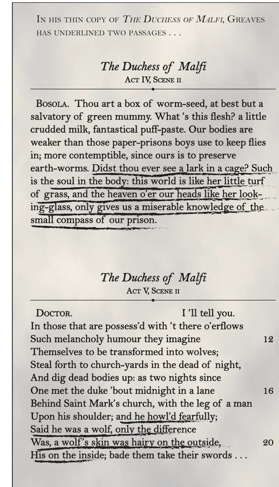

## Раздатка 7: Жаворонок в клетке

> **Раздатка 7: Жаворонок в клетке**
>
> В СВОЁМ ТОНКОМ ЭКЗЕМПЛЯРЕ «ГЕРЦОГИНИ МАЛЬФИ» ГРЕЙВЗ ПОДЧЕРКНУЛ ДВА ОТРЫВКА…
>
> **«Герцогиня Мальфи»** 
> АКТ IV, СЦЕНА II
>
> БОЗОЛА. Ты — коробка с червивым семенем, в лучшем случае — склянка с зелёной мумиёй. Что такое эта плоть? Немного свернувшегося молока, причудливое слоёное тесто. Наши тела слабее тех бумажных темниц, в которых мальчишки держат мух; и презреннее, ведь наши хранят земляных червей. <u>Видала ли ты жаворонка в клетке? Такова душа в теле: этот мир — как его клочок дёрна, а небо над нашими головами — как его зеркальце: лишь даёт нам жалкое знание о тесных пределах нашей тюрьмы.</u>
>
> **«Герцогиня Мальфи»** 
> АКТ V, СЦЕНА II
>
> ДОКТОР. Я вам скажу. 
> В тех, кто одержим этим, переливается 
> Такая меланхолия, что они мнят (12) 
> Себя оборотившимися в волков; 
> Крадутся на погосты в глухую ночь 
> И откапывают мертвецов: вот две ночи назад 
> Один встретил герцога около полуночи в переулке (16) 
> За церковью Святого Марка с человеческой ногой 
> На плече; <u>и он страшно выл;</u> 
> <u>Говорил, что он волк, только разница</u> 
> <u>В том, что у волка шерсть снаружи,</u> (20) 
> <u>А у него — внутри;</u> велел им взять мечи…

*Подчёркнуто — как в раздатке; числа в скобках — номера строк пьесы на полях.*
