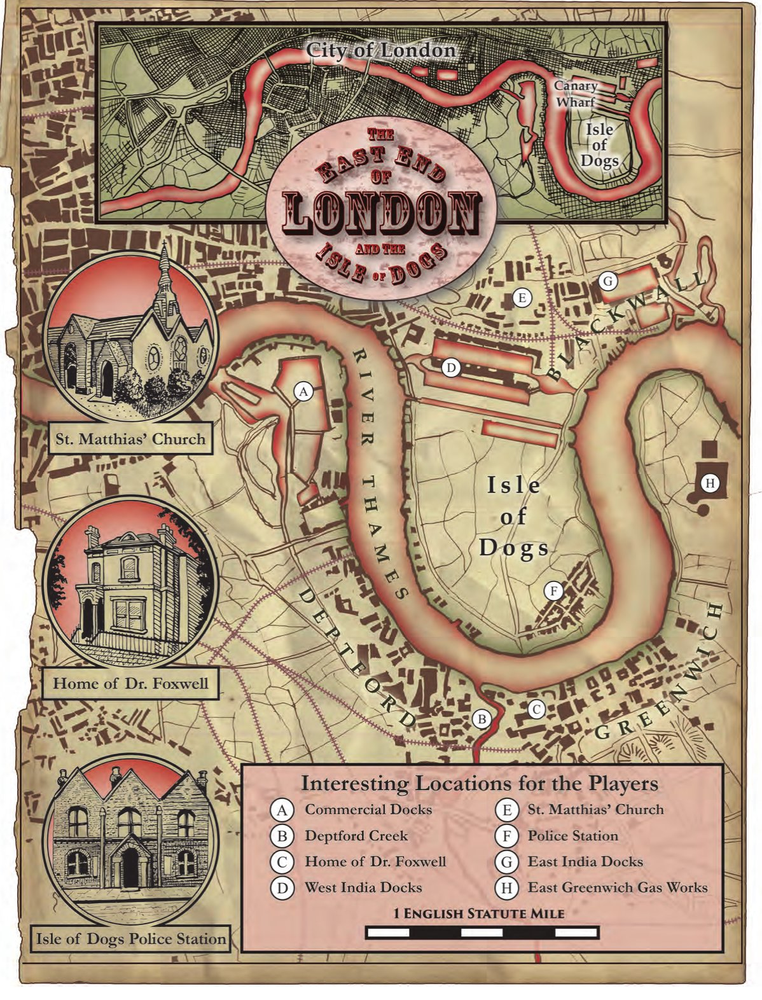

## Карта игроков

*Надписи карты — те же, что на карте Хранителя: «The East End of London and the Isle of Dogs» — Ист-Энд Лондона и Собачий остров; City of London (Сити), Canary Wharf (Канэри-Уорф), Isle of Dogs (Собачий остров), River Thames (Темза), Deptford (Дептфорд), Blackwall (Блэкуолл), Greenwich (Гринвич); виньетки — церковь Святого Матфия, дом доктора Фоксвелла, полицейский участок Собачьего острова. Масштаб: 1 English Statute Mile — 1 английская миля (1,6 км).*

**Интересные места для игроков**

| Буква | На карте | Что это |
|---|---|---|
| A | Commercial Docks | Коммерческие доки |
| B | Deptford Creek | Дептфорд-Крик |
| C | Home of Dr. Foxwell | дом доктора Фоксвелла |
| D | West India Docks | Вест-Индские доки |
| E | St. Matthias’ Church | церковь Святого Матфия |
| F | Police Station | полицейский участок Собачьего острова |
| G | East India Docks | Ост-Индские доки |
| H | East Greenwich Gas Works | Восточно-Гринвичский газовый завод |
