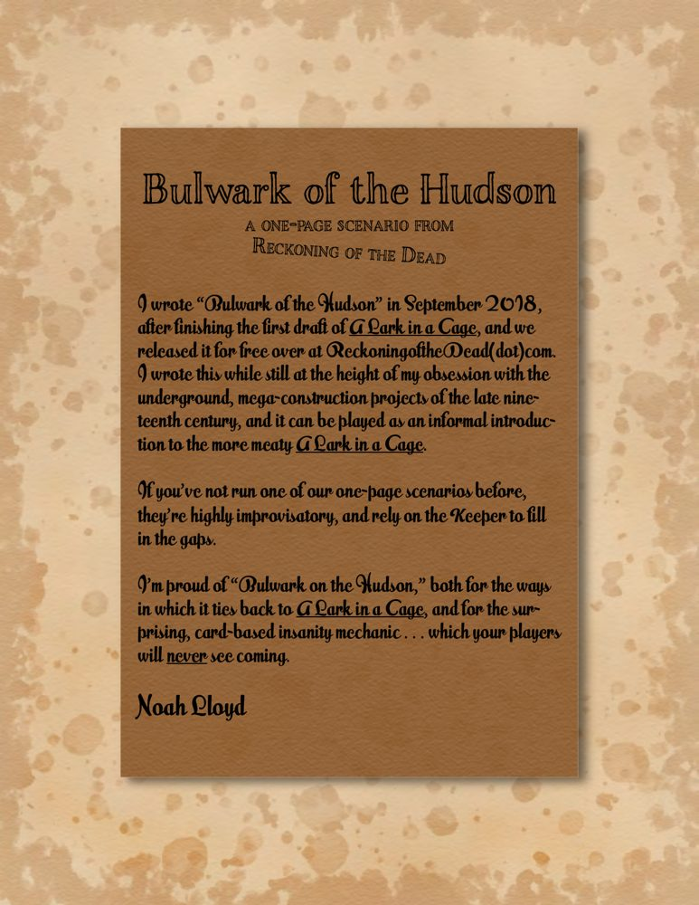

# Оплот Гудзона

Оплот Гудзона

одностраничный сценарий от Reckoning of the Dead

Я написал «Оплот Гудзона» в сентябре 2018 года, закончив первый черновик «Жаворонка в клетке», и мы бесплатно выложили его на ReckoningoftheDead(dot)com. Я писал его, ещё будучи на пике своего увлечения подземными гигантскими стройками конца XIX века, и его можно сыграть как неформальное вступление к более увесистому «Жаворонку в клетке».

Если вы ещё не водили наши одностраничные сценарии: они во многом держатся на импровизации и полагаются на то, что Хранитель заполнит пробелы.

Я горжусь «Оплотом на Гудзоне» — и тем, как он связан с «Жаворонком в клетке», и неожиданной механикой безумия на картах… которую ваши игроки *ни за что* не предугадают.

*Ной Ллойд*

*Прим. перев.: в оригинале название дано в двух видах — «Bulwark of the Hudson» и «Bulwark on the Hudson» («Оплот на Гудзоне»); основное — первое. Страницы бонуса в оригинале не пронумерованы.*
