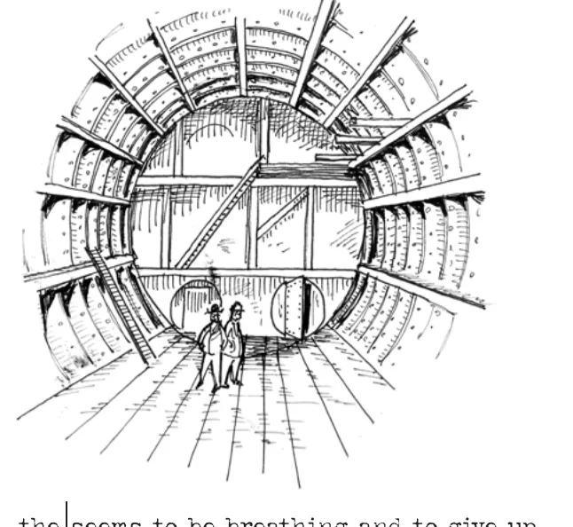

<div style="text-align:center;">
<p style="font: 600 26px/1.2 Georgia, serif; margin: 0;">ГАЗЕТА «РАСПЛАТА МЁРТВЫХ»</p>
<p style="margin: 4px 0 0;"><i>Reckoning of the Dead Gazette</i> · декабрь 1889 года · авторы — Ной Ллойд и Мэтт Райан</p>
</div>

## Оплот Гудзона

Работа над Гудзонским тоннелем, который должен соединить Джерси-Сити с Нью-Йорком проходом под дном реки, сделана примерно наполовину. Проходка «продвинулась» на 100 м с нью-йоркской стороны и на 680 м — с джерсийской. Всего пройдено чуть меньше половины из 1870 м. Подрядчик «С. Пирсон и сыновья» недавно взял проект, когда оказалось, что без британского опыта его не закончить, а британские инвесторы в мае 1889 года вложили 1,5 млн долларов. Главный архитектор проекта Эрнест Уильям Мойр изобрёл первый шлюз для рабочих, поднимающихся из тоннелей на поверхность, — он защищает их от опасной «кессонной болезни», известной также как декомпрессионная болезнь, или «бенды».

### Кессон

Сыщики встречаются за завтраком на нью-йоркской стороне строительства Гудзонского тоннеля. Один из них — **Эрнест Уильям Мойр**, главный архитектор проекта, работающий на «С. Пирсон и сыновья»; другой — **Джеймс Генри Грейтхед**, изобретатель проходческого щита Грейтхеда, которым при проходке крепят тоннель вокруг рабочих; **Филип Барлоу** — управляющий подрядчик, инженер-строитель от города; а **Майкл Калверт**, бригадир, руководит проходчиками от Нью-Йоркского профсоюза строительных рабочих. На грязной стройплощадке лифты ведут вниз к шлюзу, а буры, инструменты и большой кран ждут своего часа; накрыты длинные столы с едой и кофе. Два лифта ходят по вертикальным шахтам вглубь земли, к горизонтальной штольне под давлением примерно в 22 м внизу.

*Прим. перев.: после «щита Грейтхеда» в оригинале стоит слово «picture» — остаток вёрстки (здесь картинка щита помещена ниже).*

Холодное утро, над Гудзоном поднимается туман; приходят рабочие дневной смены и встают в очередь за кофе и кашей. Сыщики едят и болтают, когда из шахт начинает выходить ночная смена, чтобы разойтись по домам. Сначала всё идёт как обычно: примерно половина из сотни с лишним проходчиков выходит и отправляется домой после 12-часовой смены. Спуск в тоннель или подъём занимает несколько минут на одном из лифтов, а затем — проход через «кессон» Мойра, камеру, которая поддерживает давление по другую её сторону и помогает уберечь быстро поднимающихся рабочих от кессонной болезни. (Слово «шлюз» лишь недавно начало входить в обиход.) **Слух** замечает необычный скрип в одной из двух шахт лифтов, но через мгновение раздаются крики, а за ними — взрыв и большое облако дыма и пыли. **Внимание** сразу замечает, что дым идёт только из одной шахты, так что обвал тоннеля маловероятен; скорее, упал один из лифтов.

Осмотр это подтверждает. Спустятся ли сыщики сами на исправном лифте или дождутся, пока выйдут уцелевшие, кое-кто из проходчиков скажет, что поденщик **Том Маккензи** перепилил канаты, державшие платформу у подъёмной машины, и всё ещё в тоннеле — кричит, что «это место принадлежит» ему. Единственное оружие Маккензи в тоннеле — ножовка, которую он принёс с собой, но орудует он ею умело. Чтобы уговорить кого-нибудь из рабочих вернуться в тоннель и разобраться с ним, нужна трудная проверка **Убеждения** (или чрезвычайный успех других навыков общения), но если сыщикам удастся их склонить, усмирить Маккензи будет легко. Разобравшись с Томом, сыщики оценивают ущерб: одна шахта лифта выведена из строя, 18 человек погибли и почти 20 ранены (**Рассудок** 0/1d4). Эвакуация занимает время, но проходит без сложностей: людей поднимают на поверхность, и прибывает медицинская помощь.

Когда сыщики решат, что работу пора возобновить, представитель профсоюза среди рабочих (или Калверт его разыщет), **Джеф Эйкорн**, просит, чтобы руководство — то есть сыщики — лично осмотрело повреждения, прежде чем кто-то из людей спокойно вернётся к работе. При осмотре (для которого нужно пройти через кессон) **Внимание** или **Архитектура** устанавливают, что тоннель, похоже, цел. Однако у самого конца тоннеля, там, где стоит щит, **МОЩ** ощущает ужас — он будто сочится светом из песка и ила впереди проходки. Если сыщики догадаются спросить, где Маккензи проводил больше всего рабочего времени, они узнают, что у головы щита, на «первой» позиции.



### Нечто под рекой

Работа возобновляется; смены меняются медленнее, ведь работает лишь один лифт. Но через несколько часов люди начинают бежать из шахт, крича, что нашли «неестественное свечение» и что некоторые рабочие отказываются подниматься. Вернувшись в тоннель, сыщики находят рабочего, который копит лампы, кирки, мусор и всё, до чего дотянется, снова и снова крича «это моё!». Подойдя к щиту, сыщики видят тошнотворную груду прозрачной беловатой плоти, явно только что обнажённую продвижением щита. С **Вниманием** сыщики уже с расстояния больше 33 м различают, что она будто дышит и испускает странный фосфоресцирующий свет. По мере приближения сыщики чувствуют, как их разум трескается от напряжения (**Рассудок** 1/1d3). Всякий раз, когда сыщик подходит ближе 13 м, назначьте проверку **Рассудка**. При успехе он теряет 1 пункт, а при провале тянет карту из **колоды эманаций**, приложенной к сценарию. (*Примечание:* все обычные правила потери Рассудка *складываются* с эффектами **эманаций**.)

Морасс перед сыщиками — древнее существо, сложившееся из скверны тысячи мёртвых цивилизаций в злобную глыбу, забытую под землёй и водой. Оно не разумно и по-настоящему сражаться не может: его единственное действие — волны эманаций, сокрушающих рассудок; они срабатывают, когда сыщик пересекает радиус 13 м, затем 7 м, а затем каждый раунд боя (в бою существо всегда действует последним). Причудливая студенистая плоть неуязвима для огнестрельного оружия (пули отскакивают от неё и опасно рикошетят по тоннелю). Атаки по существу заставляют 11 оставшихся в тоннеле рабочих кричать от боли, но убить его можно «обычными» средствами: взрывчаткой, кислотой или, конечно, обрушив на него тоннель, — хотя инвесторы будут весьма недовольны. Если оставить его в покое, оно будет искажать разум тех, кто пользуется тоннелем, на поколения вперёд.

```stat
Скверна мёртвых городов
ЛВК 0    МОЩ 150    ПЗ 150
```

*© reckoningofthedead.com 2019*
