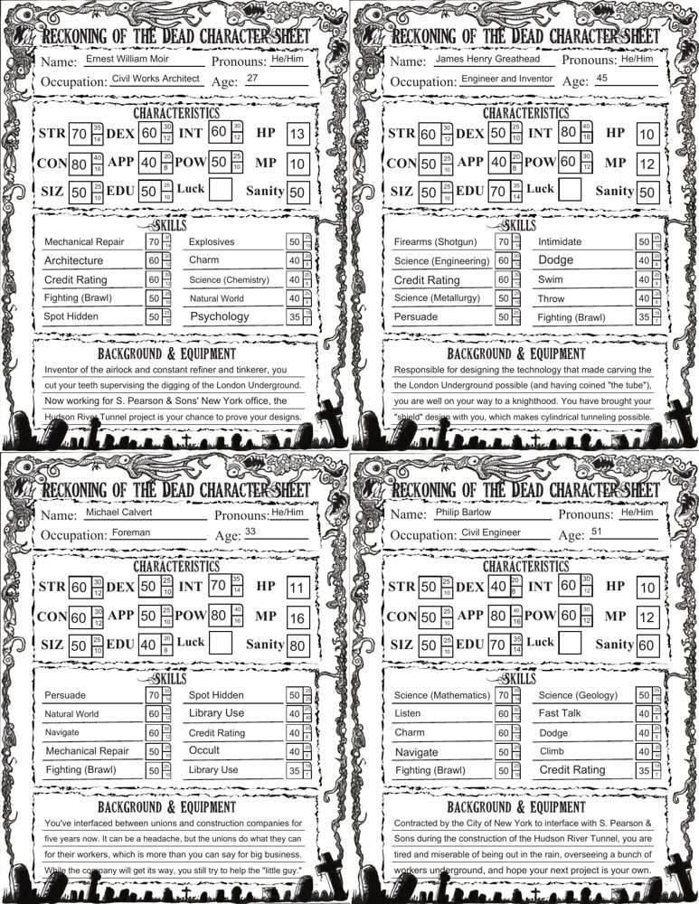

## Листы сыщиков «Оплота Гудзона»



*Четыре листа сыщиков «Reckoning of the Dead» в рамках из чудовищ и надгробий; на каждом: имя, местоимения, род занятий, возраст, характеристики (с половиной и пятой частью), навыки и предыстория. Ниже — перевод всех четырёх листов.*

### Эрнест Уильям Мойр

*Местоимения: он. Род занятий: архитектор общественных сооружений. Возраст: 27.*

```stat
СИЛ 70 (35/14)   ЛВК 60 (30/12)   ИНТ 60 (30/12)   ПЗ 13
ВЫН 80 (40/16)   НАР 40 (20/8)    МОЩ 50 (25/10)   ПМ 10
ТЕЛ 50 (25/10)   ОБР 50 (25/10)   Удача —          Рассудок 50

Навыки:
Механика                70% (35/14)    Взрывчатка              50% (25/10)
Архитектура             60% (30/12)    Обаяние                 40% (20/8)
Средства                60% (30/12)    Наука (химия)           40% (20/8)
Ближний бой (драка)     50% (25/10)    Естествознание          40% (20/8)
Внимание                50% (25/10)    Психология              35% (17/7)
```

**Предыстория и снаряжение:** изобретатель шлюза, вечно что-то улучшающий и мастерящий, вы набили руку, надзирая за прокладкой лондонской подземки. Теперь вы работаете в нью-йоркской конторе «С. Пирсон и сыновья», и строительство Гудзонского тоннеля — ваш шанс доказать, чего стоят ваши изобретения.

### Джеймс Генри Грейтхед

*Местоимения: он. Род занятий: инженер и изобретатель. Возраст: 45.*

```stat
СИЛ 60 (30/12)   ЛВК 50 (25/10)   ИНТ 80 (40/16)   ПЗ 10
ВЫН 50 (25/10)   НАР 40 (20/8)    МОЩ 60 (30/12)   ПМ 12
ТЕЛ 50 (25/10)   ОБР 70 (35/14)   Удача —          Рассудок 50

Навыки:
Стрельба (дробовик)     70% (35/14)    Запугивание             50% (25/10)
Наука (инженерия)       60% (30/12)    Уклонение               40% (20/8)
Средства                60% (30/12)    Плавание                40% (20/8)
Наука (металлургия)     50% (25/10)    Метание                 40% (20/8)
Убеждение               50% (25/10)    Ближний бой (драка)     35% (17/7)
```

**Предыстория и снаряжение:** вы создали технику, благодаря которой удалось прорыть лондонскую подземку (и придумали словечко «труба» — the tube), и вы уже на пути к рыцарскому званию. Вы привезли с собой свою конструкцию «щита», которая позволяет вести круглую проходку.

<!-- -->

### Майкл Калверт

*Местоимения: он. Род занятий: бригадир. Возраст: 33.*

```stat
СИЛ 60 (30/12)   ЛВК 50 (25/10)   ИНТ 70 (35/14)   ПЗ 11
ВЫН 60 (30/12)   НАР 50 (25/10)   МОЩ 80 (40/16)   ПМ 16
ТЕЛ 50 (25/10)   ОБР 40 (20/8)    Удача —          Рассудок 80

Навыки:
Убеждение               70% (35/14)    Внимание                50% (25/10)
Естествознание          60% (30/12)    Работа в библиотеке     40% (20/8)
Ориентирование          60% (30/12)    Средства                40% (20/8)
Механика                50% (25/10)    Оккультизм              40% (20/8)
Ближний бой (драка)     50% (25/10)    Работа в библиотеке     35% (17/7)
```

**Предыстория и снаряжение:** вот уже пять лет вы посредничаете между профсоюзами и строительными компаниями. Бывает, от этого болит голова, но профсоюзы делают для своих рабочих всё, что могут, — чего не скажешь о крупном бизнесе. Компания всё равно добьётся своего, но вы стараетесь помочь «маленькому человеку».

### Филип Барлоу

*Местоимения: он. Род занятий: инженер-строитель. Возраст: 51.*

```stat
СИЛ 50 (25/10)   ЛВК 40 (20/8)    ИНТ 60 (30/12)   ПЗ 10
ВЫН 50 (25/10)   НАР 80 (40/16)   МОЩ 60 (30/12)   ПМ 12
ТЕЛ 50 (25/10)   ОБР 70 (35/14)   Удача —          Рассудок 60

Навыки:
Наука (математика)      70% (35/14)    Наука (геология)        50% (25/10)
Слух                    60% (30/12)    Красноречие             40% (20/8)
Обаяние                 60% (30/12)    Уклонение               40% (20/8)
Ориентирование          50% (25/10)    Лазание                 40% (20/8)
Ближний бой (драка)     50% (25/10)    Средства                35% (17/7)
```

**Предыстория и снаряжение:** город Нью-Йорк нанял вас посредничать с «С. Пирсон и сыновья» на строительстве Гудзонского тоннеля; вам до смерти надоело мокнуть под дождём, надзирая за кучей рабочих под землёй, и вы надеетесь, что следующий проект будет вашим собственным.

*Прим. перев.: на листах половина от 35 везде напечатана как «18» — здесь 17. У Калверта напечатано «Внимание 50 (25/25)» и «Работа в библиотеке 40 (20/40)», у Барлоу — «Лазание 40 (20/40)»; доли исправлены. «Работа в библиотеке» у Калверта в оригинале указана дважды (40% и 35%) — оба значения оставлены. Поле «Удача» на листах пустое.*
