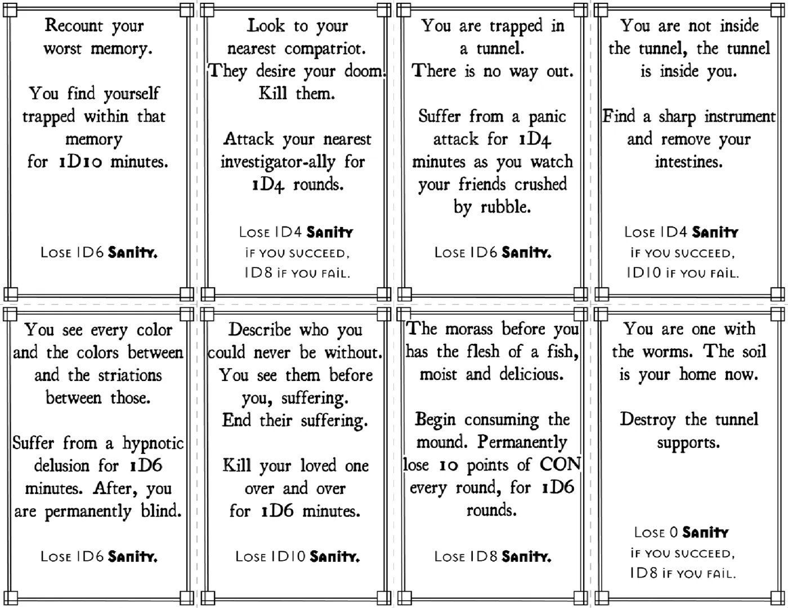

## Колода эманаций

> **Раздатка «Оплот Гудзона»: колода эманаций**
>
> *Восемь карт для вырезания. Сыщик, проваливший проверку Рассудка рядом со Скверной мёртвых городов, тянет одну карту. Порядок — как на странице: правый столбец сверху вниз, затем левый.*
>
> | Карта | Что происходит | Потеря Рассудка |
> |---|---|---|
> | 1 | **Расскажите о своём худшем воспоминании.** Вы оказываетесь заперты в нём на 1d10 минут. | 1d6 |
> | 2 | **Взгляните на ближайшего товарища.** Он желает вам гибели. Убейте его. Атакуйте ближайшего союзника-сыщика в течение 1d4 раундов. | 1d4, если преуспеете; 1d8 — если нет |
> | 3 | **Вы заперты в тоннеле.** Выхода нет. Вас охватывает паническая атака на 1d4 минуты, пока вы смотрите, как ваших друзей давит обвал. | 1d6 |
> | 4 | **Не вы внутри тоннеля — тоннель внутри вас.** Найдите что-нибудь острое и извлеките свои внутренности. | 1d4, если преуспеете; 1d10 — если нет |
> | 5 | **Вы видите каждый цвет, и цвета между ними, и прожилки между теми.** Вы впадаете в гипнотический бред на 1d6 минут. После вы навсегда слепнете. | 1d6 |
> | 6 | **Опишите того, без кого вы не смогли бы жить.** Вы видите его перед собой, страдающим. Прекратите его страдания. Убивайте любимого человека снова и снова в течение 1d6 минут. | 1d10 |
> | 7 | **У морасса перед вами плоть рыбы, влажная и восхитительная.** Начните пожирать эту груду. Навсегда теряйте 10 пунктов ВЫН каждый раунд в течение 1d6 раундов. | 1d8 |
> | 8 | **Вы едины с червями.** Теперь почва — ваш дом. Разрушьте крепь тоннеля. | 0, если преуспеете; 1d8 — если нет |
