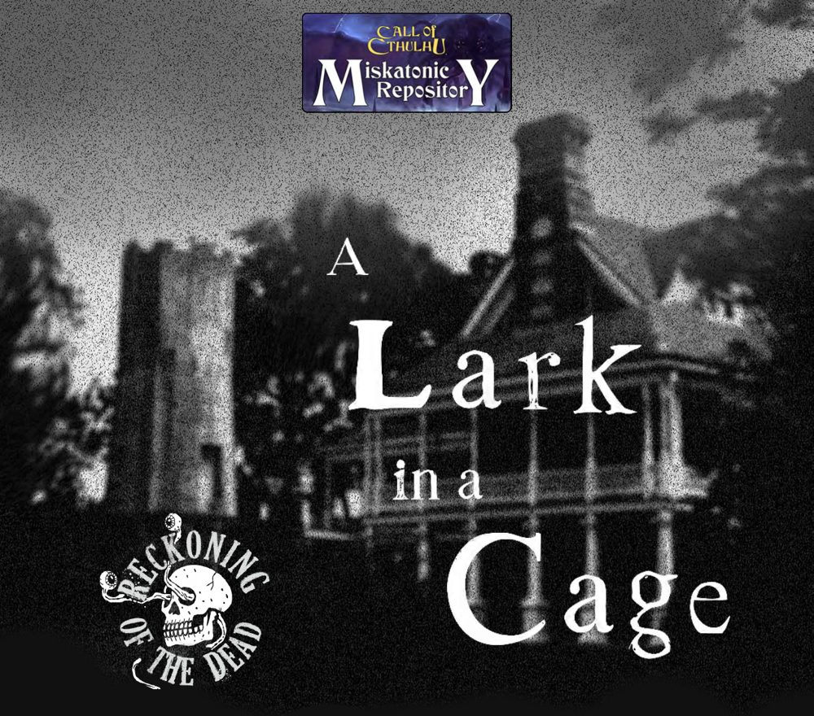

# Задняя обложка

Сценарий на две-три встречи для эпохи «Газового света» седьмой редакции *«Зова Ктулху»*.

Идёт 1895 год. Только что закончился суд над Оскаром Уайльдом, и об этом пишут газеты по всему Лондону. В Дептфорде одна семья обнаруживает, что их ребёнка подменили… чем-то *другим*. Взявшись за дело, сыщики отправляются по задымлённым сажей улицам Восточного Лондона, открывая новые угрозы городу, коварных врагов и ещё более коварных союзников, — и наперегонки со временем пытаются спасти ребёнка.

В книге — шесть готовых сыщиков, советы, как вписать сценарий в вашу собственную идущую кампанию «Газового света», и сведения об эпохе и месте — лондонском Ист-Энде, на редкость грязном городе, где нищета и богатство живут бок о бок. Это время детских потогонных мастерских и клубов дыма, складывающихся в печально знаменитый вредный смог. Чтобы выжить, сыщикам придётся пробираться по этому миру, полному опасностей — и природных, и противоестественных.
