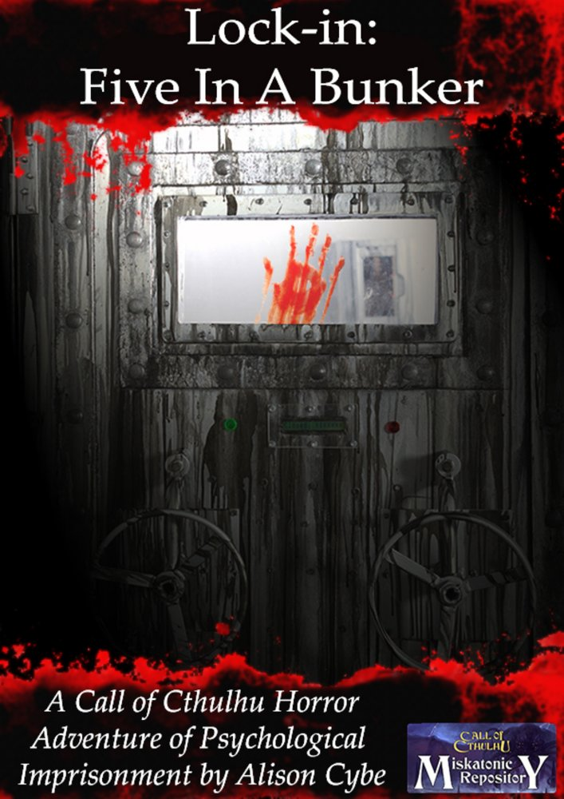

ВЗАПЕРТИ: ПЯТЕРО В БУНКЕРЕ

Хоррор-приключение для «Зова Ктулху» о психологическом заточении

Элисон Сайб

*На обложке — стальная дверь бункера с двумя штурвалами; на стекле иллюминатора — кровавый отпечаток ладони. Вверху — название «Lock-in: Five In A Bunker», внизу — подзаголовок «A Call of Cthulhu Horror Adventure of Psychological Imprisonment by Alison Cybe» и логотип «Call of Cthulhu — Miskatonic Repository».*
