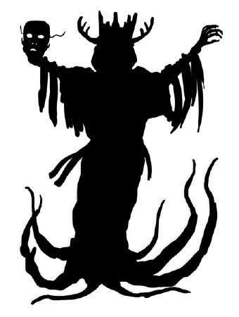

# Вступление

Ад — это другие, говорят.

Многие игры построены на исследовании: переходы с места на место, встречи с противниками, осмотр предметов и мест. Из этого и складывается большое приключение. Но не у всех историй это общее. Порой самые напряжённые и жуткие моменты рождаются из приливов и отливов паранойи, которая возникает, когда некуда деться от своих спутников.

Представьте, что вы заперты в комнате, полной незнакомцев. Вы не знаете, кто они, и не уверены в их мотивах. У всех нас в жизни бывали такие моменты, но, к счастью, редко, и жизни они почти никогда не угрожают.

Эта игра берёт пятерых игроков и запирает их в комнате. Снаружи что-то есть — что-то ужасное. Но настоящее напряжение в этом приключении рождается из того, как ваши игроки будут взаимодействовать друг с другом.

Сначала у меня была мысль сделать что-то вроде «квеста в комнате». Скоро стало ясно, что это не совсем работает — по крайней мере без чего-то более ощутимого, что угрожало бы сыщикам. В конце концов, «Зов Ктулху» — игра о хрупкости человеческого рода перед космическими ужасами, более грандиозными и страшными, чем способен постичь смертный разум. Поэтому мне показалось, что лучше всего показать это игрой, которая сталкивает персонажей с другим смертельным врагом — с ними самими.

У каждого сыщика в этом приключении есть набор мотивов. Они постепенно открываются игроку по ходу приключения, и игра использует то, что игрок не знает своего положения, чтобы создать среду, в которой может расцвести ужас.

Однако стоит сразу сказать: эта игра понравится не всем. В этом приключении жизненно важно согласие всех игроков: каждый должен спокойно объявлять перерыв в любой момент, а Хранитель, который его ведёт, — готов приложить усилия, чтобы свести к минимуму эмоциональный перенос. Я советую каждому Хранителю, который думает провести это приключение, сначала обсудить все эти темы с игроками и убедиться, что все согласны и всем комфортно — не только в начале игры, но и в любой её момент.

Кроме безудержной паранойи и мотивов, натравливающих сыщиков друг на друга, эта игра говорит об изоляции. Главное здесь — чувство западни: ты заперт в тесном месте, и выхода нет. Пятеро просыпаются и обнаруживают, что заперты в камере. Внешний мир — воспоминание, солнечный свет — мимолётный сон. Отвлечься от наступающей тишины можно только на тех, кто рядом, — людей, которые требуют вашего доверия и так же чужды вам, как вы сами себе.

Добро пожаловать в бункер. Попробуйте выбраться живыми.

— Элисон Сайб

