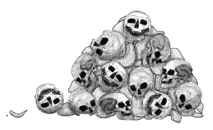

Когда сыщики увидят удостоверение Сэндфорда, раздайте каждому игроку «Раздатку № 2» его сыщика.

В Акте 1 игроки получают две раздатки. С раздаткой № 1 главная задача группы — разобраться, кто они такие, и впервые нащупать отношения и расстановку сил между собой. Здесь два испытания: один из группы явно ранен, а другой в панике. Вряд ли они разрешатся в этом акте, но их присутствие сильно скажется на динамике группы.

Раздатка № 2 даёт и темы для споров, и ключевой инструмент — оружие. Сам этот предмет становится инструментом власти, и двое персонажей будут добиваться, чтобы он был только у них. Тот, у кого этот предмет, окажется во власти над остальными в группе. Владелец оружия может почувствовать власть и авторитет над остальными — может быть, из ошибочного чувства лидерства, — но тем самым выделит себя среди товарищей. Пусть эта динамика поработает какое-то время, а подозрения забродят.

Когда будете готовы перейти к следующему акту, можете прочитать или пересказать следующее.

> *«Вас приводит в чувство внезапный громкий стук в дверь. Повернувшись к ней, вы видите лицо мужчины. Он яростно колотит в прозрачный иллюминатор, пытаясь привлечь ваше внимание. „Вы меня слышите?“ — кричит он, слова приглушает дверь. — „Слава богу! Слушайте, вы должны меня впустить. Оно всё ещё здесь. Господи, я даже не знаю, сколько нас осталось, так трудно понять из-за осколков. Впустите меня!“ Он колотит в дверь — и замирает. Его взгляд обращается вправо, и он кричит. Его голову бросает вперёд, и она разбивается о дверь. От удара воистину нечеловеческой силы по стеклу расходится большая паутина трещин. Он снова кричит, и воздух наполняется влажным звуком раздираемой плоти. Кровь заливает прозрачный иллюминатор, а вместе с ней — куски чего-то похожего на мясо. Потом крики стихают».*

Все сыщики должны пройти проверку Рассудка 1d4/1d8.

## Акт 2

Раздайте каждому игроку «Раздатку № 3» его сыщика и дайте время их прочитать.

Гончая Тиндала только что растерзала единственного живого человека, которого встретили сыщики, и сейчас их главной заботой должна быть собственная безопасность. Чтобы что-то рассмотреть в иллюминаторе, нужна успешная проверка Внимания: он почти весь залеплен кровью. Сквозь кровь можно различить изуродованное тело солдата. Его утащили на тридцать ярдов по коридору, но даже на таком расстоянии сыщики могут разглядеть кое-какие вещи при нём — в том числе аптечку, пристёгнутую к поясу, и рацию, торчащую из кармана на бедре. Гончей не видно.
