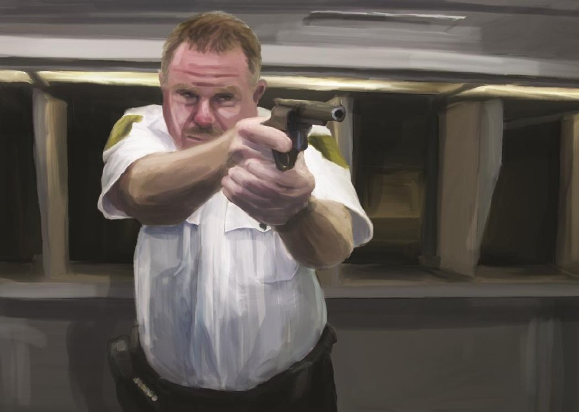

Дайте сыщикам достаточно времени, чтобы обсудить положение, поспорить между собой и решить, что делать. Теперь можно разбить плотное стекло, треснувшее от жестокого удара, — для этого нужны три успешные проверки СИЛ, чтобы стекло рассыпалось целиком. Проверка проходит с бонусной костью (игрок бросает дополнительную кость «десятков» и выбирает лучший результат), если сыщики догадаются выбивать стекло пистолетом или похожим металлическим предметом.

Если проверки пройдены подряд, одна за другой, стекло легко разобьётся, — но если любая проверка после первой провалена, стекло разобьётся опасно, и следующая часть побега станет трудной. Иллюминатор слишком узок, чтобы в него протиснулся кто-то из сыщиков. Штурвал на внутренней стороне двери слишком туго ходит, чтобы открыть его изнутри, однако успешная проверка Идеи подскажет, что если вращать его одновременно с наружным штурвалом, дверь должна открыться. Если стекло разбилось опасно, сыщик, который просунет руку, чтобы повернуть штурвал, порежет руки и получит 1d6 урона от кровотечения.

Выходить из камеры чрезвычайно опасно. Коридор кажется пустым и остаётся пустым, пока на него смотрят изнутри камеры. Но как только сыщик отходит от комнаты на пять ярдов, время вокруг него дробится на осколки. На него обрушиваются видения прошлого: полупрозрачный образ мёртвого солдата, лежащего в коридоре, подбегает к двери и колотит в неё, повторяя свои последние мгновения. Сыщик слышит сверху крики, отдающиеся эхом, будто из-под воды, и видит призрачные образы себя и других сыщиков вместе с Сэндфордом, которые бегут, чтобы укрыться в камере. Видения раздробленного времени требуют проверки Рассудка 1d6/1d10.

