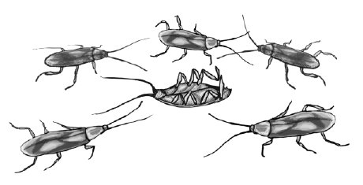

недоверие неуклонно растёт и в этом акте вполне может прорваться. В этом столкновении сыщики вполне могут погибнуть. Если так случится — что ж, Акт 3 обещает, что они, возможно, исчезнут ненадолго, — но выжившие сыщики на этом этапе наверняка запомнят поступки убийцы.

Короче говоря, этот акт усиливает угрозу, которую сыщики представляют друг для друга, и в такие моменты Хранителю стоит изо всех сил стараться не вмешиваться. Кроме того, в этом акте должна впервые появиться раздатка A — она должна сильно обострить подозрительность и тревогу между сыщиками, когда они заметят, что её получатель ведёт себя всё страннее.

## Акт 3

Раздайте каждому игроку «Раздатку № 4» его сыщика и дайте время их прочитать. Если у сыщика, получившего раздатку A, по-прежнему наименьший оставшийся запас Рассудка, дайте ему раздатку B; если наименьший запас Рассудка теперь у другого сыщика, дайте раздатку A ему.

К этому моменту напряжение будет высоким, и сыщики вполне могут вцепиться друг другу в глотки. Путь наружу один — обратить вспять ритуал, высвободивший хаос: это залечит осколки времени и изгонит Гончую. У каждого игрока в раздатках есть часть ритуала, и теперь сыщикам предстоит сообща его провести. Если все пятеро сыщиков живы, это будет сравнительно легко. Но если один или несколько мертвы — что ж, это несколько труднее.

Но не невозможно. Успешная проверка Идеи подскажет, что раз время вокруг дробится на осколки, сыщики, возможно, смогут пробраться в тот момент прошлого, когда никто из их погибших товарищей ещё не был убит, и вернуться с ними в камеру. Если товарища убила Гончая, это будет самая настоящая спасательная операция. Но если товарища убил кто-то из сыщиков, нет никакой гарантии, что он будет сговорчив. Большая часть первой половины этого акта — свободная игра, вплоть до середины ритуала.

Сквозь осколки времени можно пройти по туннелю. Сыщиков, которые отправятся в этот путь, захлестнут новые видения, образы и звуки давно минувших и ещё грядущих времён. С каждым шагом они видят, как строят туннель, как по нему снуют туда-сюда военные, как туннель рушится и приходит в запустение, как дрожит земля под тяжестью бомб, рвущихся далеко наверху,
