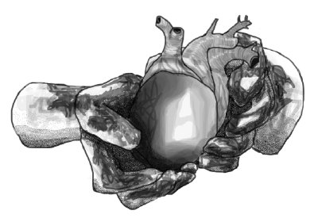

и раз за разом повторять напев.

У каждого сыщика есть строка напева, а кровь можно взять у любого из сыщиков или с тела Сэндфорда. Когда ритуал начинается, Хранителю стоит описать, как сгущается атмосфера. Будет ещё веселее, если предложить игрокам прочитать свои строки вслух, но это не обязательно, и давить на них не стоит.

Когда ритуал начнётся, прочитайте или перескажите следующее.

> *«Вы набираете кровь из мёртвого тела и, как можете точнее по памяти, начинаете воссоздавать круг. Это непросто, но примерно через час вы уверены, что всё сделали правильно. Вы встаёте на равных расстояниях друг от друга вокруг круга и начинаете напев. Сначала кажется, что всё напрасно: на ваши слова отвечает лишь неловкая тишина. Затем вы постепенно начинаете ощущать, как в воздухе вокруг вас набухает и бурлит энергия. Камеру прорезает резкий холодный ветер. Из-под земли доносится неровный гул. На миг вы почти сбиваетесь, но продолжаете, повторяя слова снова и снова, пока не начинает пересыхать горло. Свет в камере начинает меркнуть, а затем становится багрово-красным. Вы поднимаете глаза и понимаете, что этот оттенок дают густые капли крови, которые стекают по стенам камеры, как дождь по запотевшему окну. А затем из самой дальней дали прорывается вой — не ветра, а какого-то странного, чуждого существа — и дюйм за дюймом приближается».*

В разгар ритуала дайте игроку, получившему раздатку B, экземпляр раздатки C. Теперь все присутствующие сыщики должны пройти проверку Рассудка: они видят, как Гончая вырывается из единственного угла в комнате — из уголка глаза жертвы.



> **«Вырежи его!»**
>
> В этот момент игрок с раздаткой B может попытаться принять меры. Увы, это бесполезно: сыщику суждено лишиться глаза в кульминации приключения. Предотвратить это не может ничто, кроме смерти сыщика, — даже удаление поражённого глаза (что наносит дополнительно 1d12 урона). Гончая всё равно вырвется из уголка глаза, что бы ни случилось, — даже если сыщик умрёт раньше!

### Гончая Тиндала

```stat
СИЛ 80    ВЫН 150   ТЕЛ 85
ЛВК 50    ИНТ 85    МОЩ 120
ПЗ 23

Средний бонус к урону: +1d6
Скорость: 6
Атак за раунд: 1

Ближний бой 90%, урон 1d6 + БкУ + ихор (2d6 урона за раунд, пока его не удалят)
Язык 90%, вытягивает 3d6 МОЩ за раунд
```
