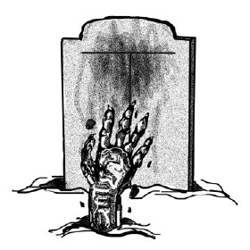

# Противники

## Гончая Тиндала

```stat
СИЛ 80    ВЫН 150   ТЕЛ 85
ЛВК 50    ИНТ 85    МОЩ 120
ПЗ 23

Средний бонус к урону: +1d6
Скорость: 6
Атак за раунд: 1

Ближний бой 90%, урон 1d6 + БкУ + ихор (2d6 урона за раунд, пока его не удалят)
Язык 90%, вытягивает 3d6 МОЩ за раунд
```

**Атаки ближнего боя:** гончая может атаковать лапами или укусом.

Гончая Тиндала покрыта чем-то вроде голубоватого гноя (ихора). Когда жертву поражает атака ближнего боя, её обдаёт сгустком этой слизи. Эта гноеподобная масса жива и активна: она наносит цели 2d6 урона, и столько же урона наносится каждый раунд, пока ихор остаётся на теле жертвы. Ихор можно стереть куском одежды, пройдя проверку ЛВК.

**Язык:** раз в раунд при успешной атаке языком образуется глубокая проникающая (хотя бескровная и безболезненная) рана. Несмотря на странную рану, жертва не получает физического урона, но безвозвратно теряет 3d6 МОЩ.

## Лейтенант Сэндфорд

```stat
СИЛ 60    ВЫН 65    ТЕЛ 45
ЛВК 70    ИНТ 60    МОЩ 70
ПЗ: 13
Скорость: 12
Атак за раунд: 1

Удар кулаком: 55%, урон 1d4 + 2
Пистолет: 50%, урон 2d6 + 4
Уклонение 55%
```

*Прим. перев.: так в оригинале — ПЗ 13 (по правилам (ВЫН 65 + ТЕЛ 45) / 10 = 11) и Скорость 12 (у человека с такими характеристиками — 9).*


