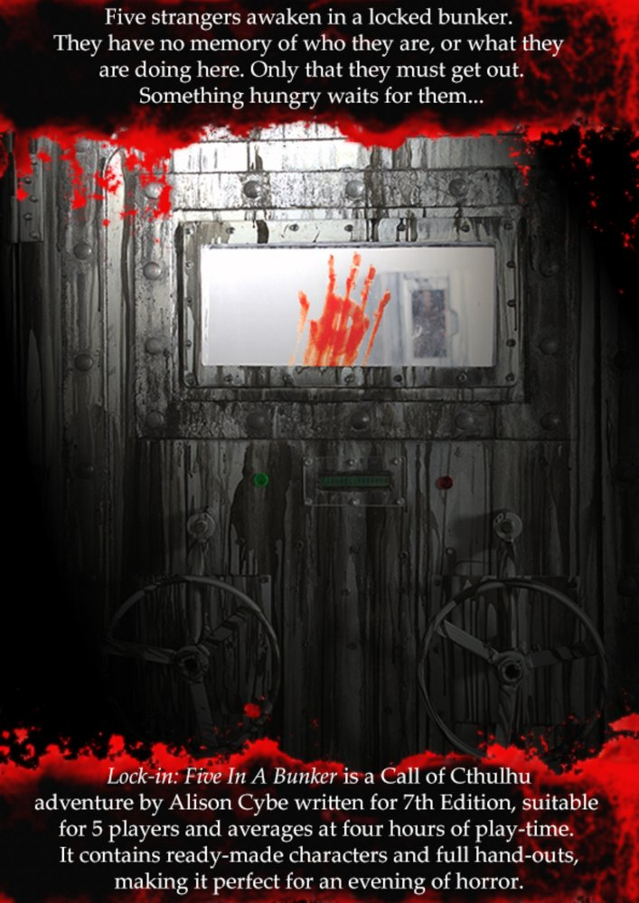

# Задняя обложка

*Пятеро незнакомцев просыпаются в запертом бункере. Они не помнят, кто они и что здесь делают. Знают лишь одно: отсюда надо выбраться. Их ждёт что-то голодное…*

*«Взаперти: пятеро в бункере» — приключение Элисон Сайб для «Зова Ктулху» 7-й редакции на 5 игроков, в среднем на четыре часа игры. В нём есть готовые персонажи и все раздатки — идеально для вечера ужасов.*
